# Lecture 01 — External Sorting and Tournament Trees

## 1. Lecture Context

This lecture introduces data structures and techniques used when the data being processed is too large to fit entirely in main memory.

> **Lecture flow:** understand the disk-memory model → adapt quicksort and merge sort → speed up multiway merging with tournament trees → apply tournament trees to bin packing.

**Topics in the module**

- External sorting
- Single-ended and double-ended priority queues
- Dictionaries
- Multidimensional search
- Computational geometry
- Image processing
- Packet routing and classification

The analysis of these structures may involve:

- **Worst-case complexity** — the maximum cost for an input of size $n$.
- **Average-case complexity** — the expected cost over a distribution of inputs.
- **Amortized complexity** — the average cost per operation over a sequence of operations, even if some individual operations are expensive. ක්ෂය කර ඇත

**Prerequisites**

- Asymptotic notation: $O$, $\Theta$, and $\Omega$
- Stacks and queues
- Linked lists
- Trees
- Graphs
- Programming in C++, Java, or Python

---

## 2. External Sorting and the I/O Model

**External sorting** is the process of sorting records that reside on secondary storage, such as a disk, when all the records cannot be held in main memory at the same time.

This may happen when:

- The number of records $n$ is very large.
- Each individual record is very large.
- Both the number and size of the records are large.

Therefore, the usual approach of reading all records into memory, sorting them, and writing the result back is not feasible.

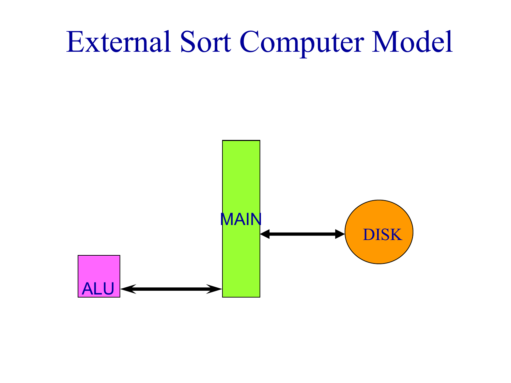

*External sorting repeatedly transfers blocks between disk and main memory.*

**Important supporting concepts**

- Tournament trees
- Huffman trees
- Double-ended priority queues
- Buffering

---

**Why disk access matters**

External sorting is dominated by the cost of input/output rather than arithmetic operations.

**Disk characteristics**

| Component | Meaning | Approximate cost from the lecture |
| --- | --- | ---: |
| Seek time | Moving the read/write head to the required track | About 100,000 arithmetic operations |
| Rotational latency | Waiting for the required sector to rotate under the head | About 25,000 arithmetic operations |
| Transfer time | Time required to move the data | Depends on the amount transferred |

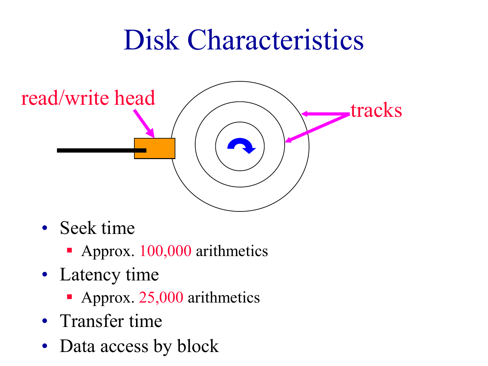

*Disk access includes seek time, rotational latency, and data-transfer time.*

Disks transfer data in **blocks**, so an external algorithm should minimize the number of block transfers and avoid many small, scattered accesses.

**Memory hierarchy**

The closer memory is to the processor, the faster and smaller it generally is.

| Level | Example size in the lecture | Approximate access cost |
| --- | ---: | ---: |
| Registers | 8–32 values | 1 cycle |
| L1 cache | 32 KB | 2 cycles |
| L2 cache | 256 KB | 10 cycles |
| Main memory | 1 GB | 100 cycles |
| Disk | Much larger | Far slower than main memory |

> **Key idea:** In external algorithms, reducing disk I/O is usually more important than saving a small number of CPU operations.

---

**Choosing an internal sorting method**

External sorting methods are often based on efficient internal sorting algorithms:

- **Quicksort** has excellent average running time.
- **Merge sort** provides strong worst-case guarantees and naturally supports sequential block access.

---

## 3. External Quicksort

**Internal quicksort refresher **

https://www.geeksforgeeks.org/dsa/quick-sort-algorithm/

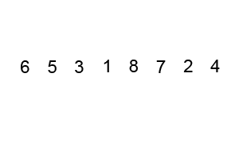

For an array of $n$ elements:

1. Select a pivot.
2. Partition the elements into three groups:
   - **Left:** values less than or equal to the pivot
   - **Middle:** the pivot
   - **Right:** values greater than or equal to the pivot
3. Recursively sort the left and right groups.
4. Concatenate the sorted left group, middle group, and sorted right group.

**Partitioning example**

Given:

```text
6 2 8 5 11 10 4 1 9 7 3
```

Using `6` as the pivot gives:

```text
Left:   2 5 4 1 3
Middle: 6
Right:  8 11 10 9 7
```

The left and right groups are then sorted recursively.


---

**External adaptation**

The external version divides the available memory into:

- An **input buffer**
- A **small-record output buffer**
- A **large-record output buffer**
- A large in-memory **middle group**

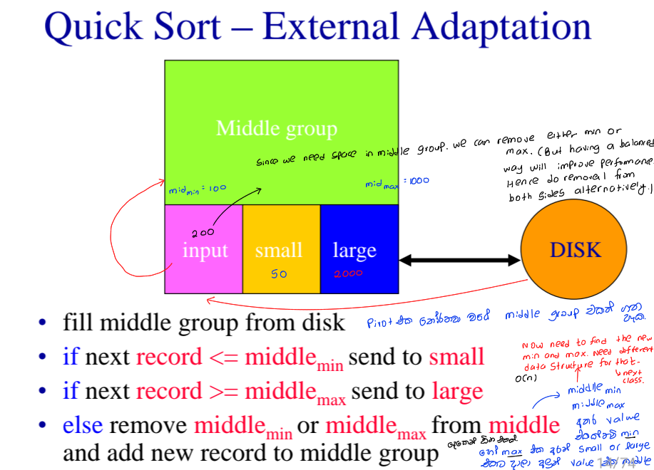

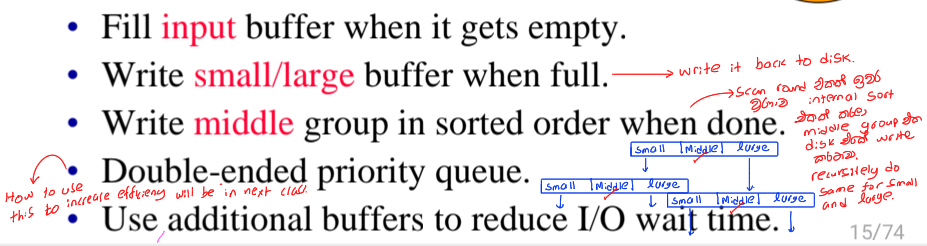

*External quicksort uses input, small, and large buffers while keeping the middle partition in memory.*

**Procedure**

1. Fill the middle group with records from disk.
2. Track the minimum and maximum values currently in the middle group: `middleMin` and `middleMax`.
3. Process each remaining input record:
   - If the record is $\leq$ `middleMin`, send it to the small-record buffer.
   - If the record is $\geq$ `middleMax`, send it to the large-record buffer.
   - Otherwise, insert it into the middle group and remove either its current minimum or maximum to an appropriate output buffer.
4. Refill the input buffer whenever it becomes empty.
5. Write a small or large buffer to disk whenever it becomes full.
6. When the scan finishes, write the middle group in sorted order.
7. Recursively sort the small and large partitions.

==Efficiently finding and removing both the minimum and maximum values requires a **double-ended priority queue**.==

Additional buffers can be used to overlap disk I/O with processing and reduce waiting time.

---

## 4. External Merge Sort

**Internal merge sort refresher**

https://www.geeksforgeeks.org/dsa/merge-sort/

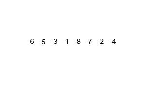

Merge sort has two phases:

1. **Create initial sorted segments**
   - Use naturally occurring sorted segments, or
   - Create small sorted segments using an internal method such as insertion sort.
2. **Merge sorted segments**
   - Repeatedly merge pairs of segments in merge passes until only one sorted segment remains.

This structure makes merge sort especially suitable for external sorting.

---

**External merge-sort process**

External merge sort also has two phases:

> [!TIP]
>
> 1. **Run generation** — create sorted sequences called runs.
> 2. **Run merging** — repeatedly merge the runs until one sorted run remains.
>

> A **run** is a sequence of records already in sorted order.
>

### Worked Example: Sorting 10,000 Records

Assume:

| Quantity | Value |
| --- | ---: |
| Number of records | 10,000 |
| Memory capacity | 500 records |
| Block size (size of the block that we can transfer from memory to disk at one time) | 100 records |
| Total input size | 100 blocks |
| Blocks held in memory | 5 blocks |

Let:

- $t_{IO}$ = time to input or output one block, including seek, latency, and transfer time
- $t_{IS}$ = time to internally sort one memory load
- $t_{IM}$ = time to internally merge one block load

**Phase 1 — Run generation**

For each memory load:

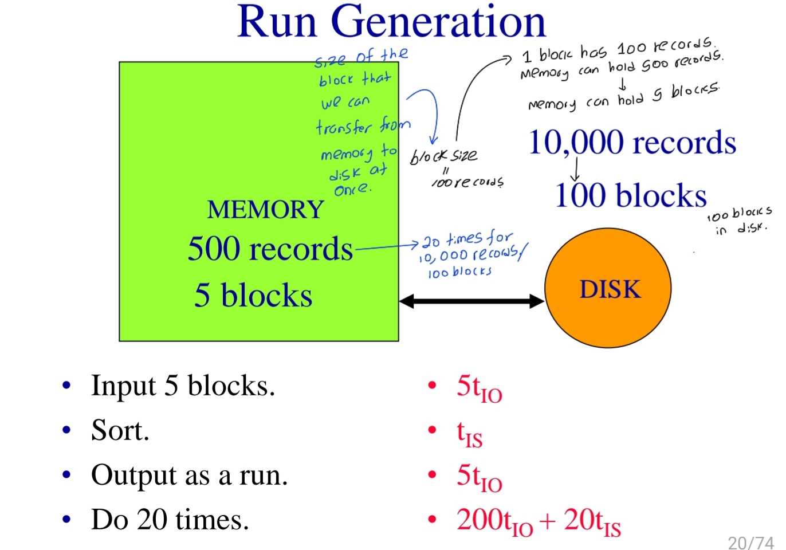

*Five blocks are read, sorted internally, and written as one run; the process is repeated 20 times.*

1. Read 5 blocks: $5t_{IO}$
2. Sort the 500 records: $t_{IS}$
3. Write the sorted run of 5 blocks: $5t_{IO}$

The number of initial runs is:

$$
r = \frac{10{,}000}{500} = 20
$$

Therefore, total run-generation time is:

$$
20(5t_{IO} + t_{IS} + 5t_{IO})
= 200t_{IO} + 20t_{IS}
$$


**Phase 2 — Two-way run merging**

Pairwise merging reduces the number of runs as follows:

```text
20 → 10 → 5 → 3 → 2 → 1
```

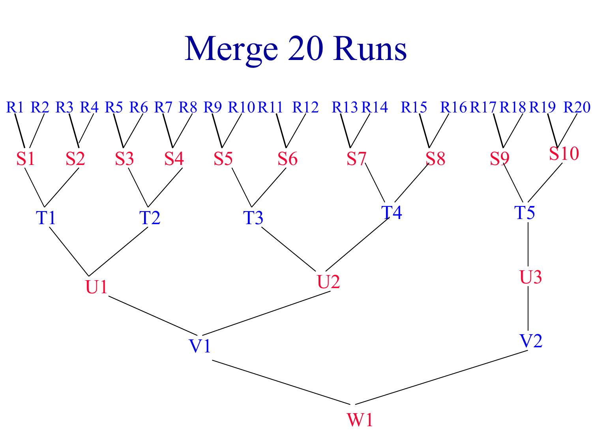

*Two-way merging reduces 20 runs to one run in five passes.*

Thus, the number of merge passes is:

\(2^4=16<20\leq32=2^5\)  -> final odd one causes the confusion (When there is an odd number of runs, the unpaired run is carried into the next pass.)
$$
\left\lceil \log_2 20 \right\rceil = 5
$$

**How two runs are merged**

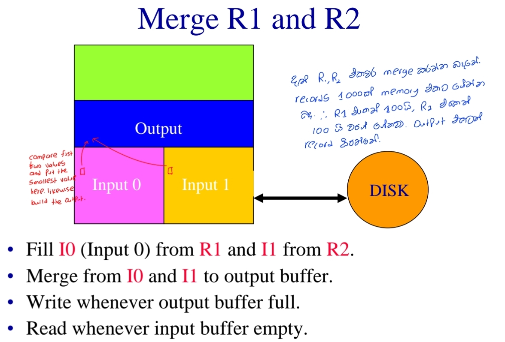

Use three buffers:

- One input buffer for the first run
- One input buffer for the second run
- One output buffer

The algorithm repeatedly:

1. Fills each input buffer from its run.
2. Moves the <u>smaller</u> front record to the output buffer. 
3. Refills an input buffer when it becomes empty.
4. Writes the output buffer when it becomes full.

For example, merging two runs that are each 5 blocks long costs:

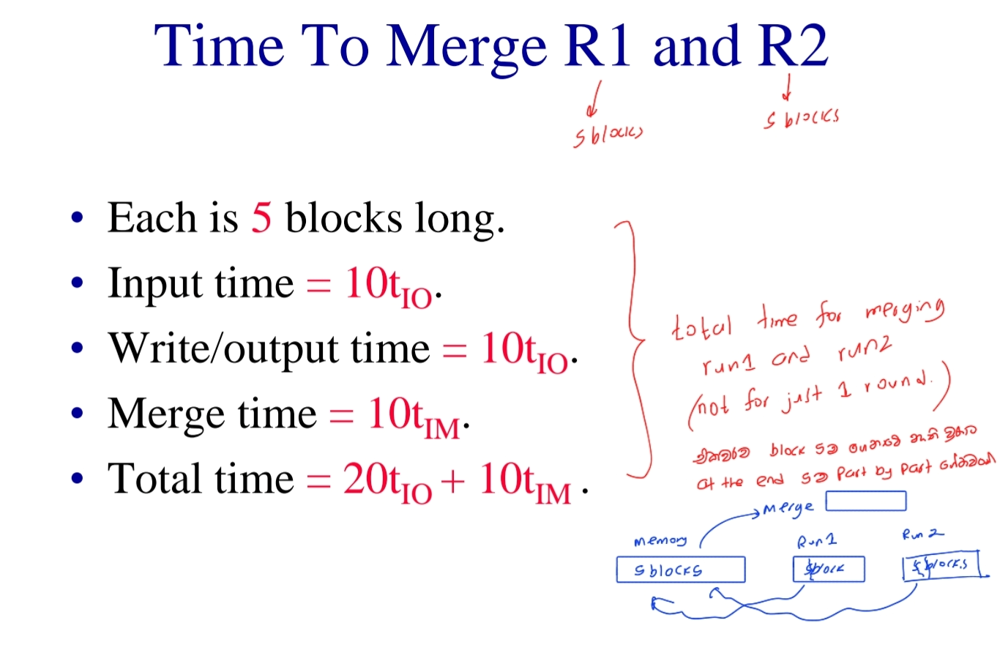

| Work | Cost |
| --- | ---: |
| Read 10 blocks | $10t_{IO}$ |
| Write 10 blocks | $10t_{IO}$ |
| Internally merge 10 blocks | $10t_{IM}$ |
| **Total** | $20t_{IO} + 10t_{IM}$ |

**Cost of one complete merge pass**

Every pass reads and writes all 100 blocks:

| Work | Cost |
| --- | ---: |
| Read all blocks | $100t_{IO}$ |
| Write all blocks | $100t_{IO}$ |
| Internal merging | $100t_{IM}$ |
| **Total per pass** | $200t_{IO} + 100t_{IM}$ |

in each merge parse -> need to read, write and merge all the blocks => Time is equal

Therefore, the total run-merging time is:
$$
(200t_{IO} + 100t_{IM})
\left\lceil \log_2 20 \right\rceil
= 5(200t_{IO} + 100t_{IM})
$$

> [!NOTE]
>
> 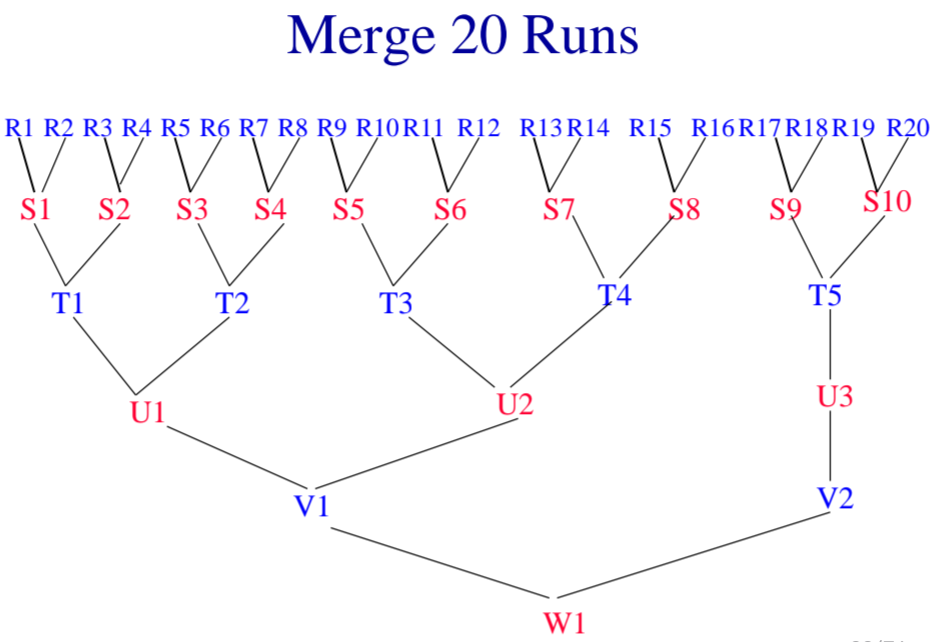
>
> 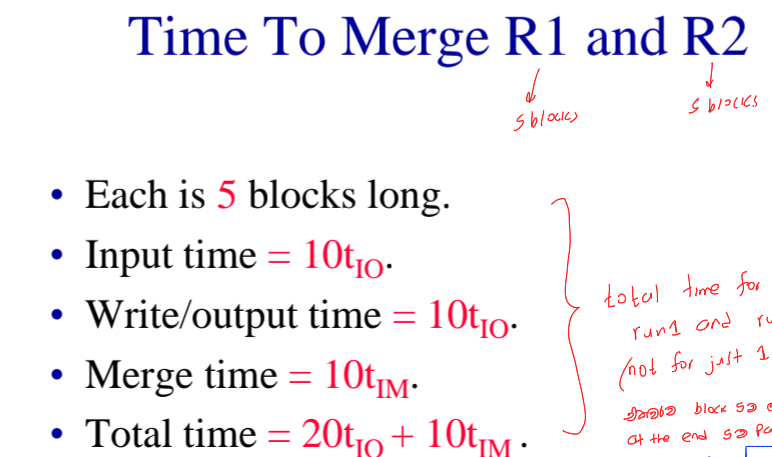 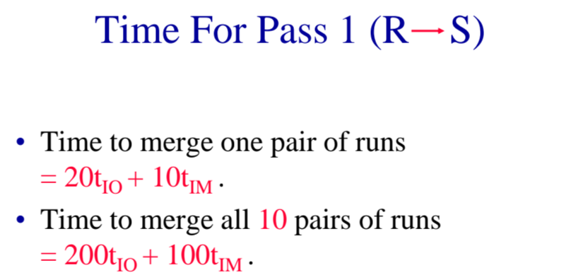
>
> 
>
> 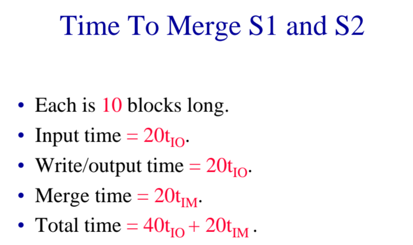 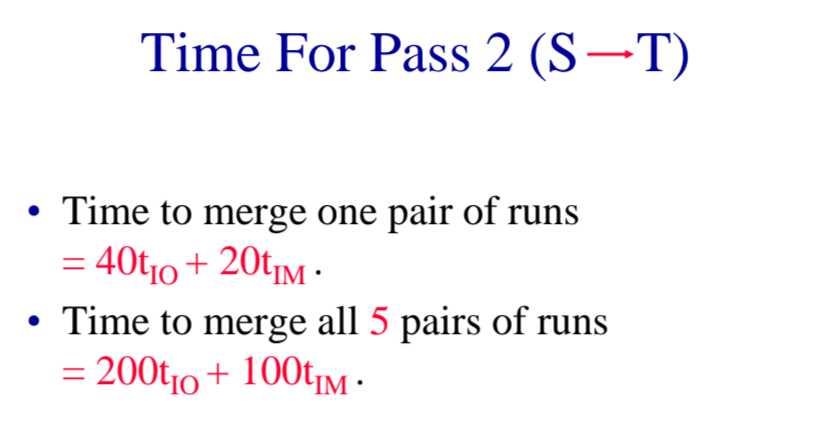
> 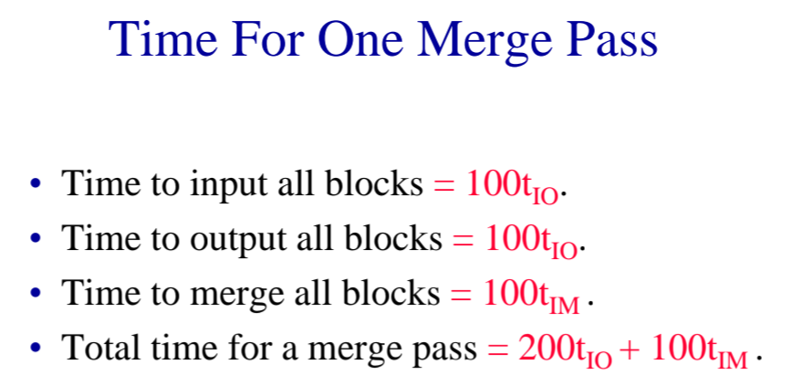
> For each pass even though number of pairs become half, block size becomes 2x so always time for one merge pass remains same.
>
> 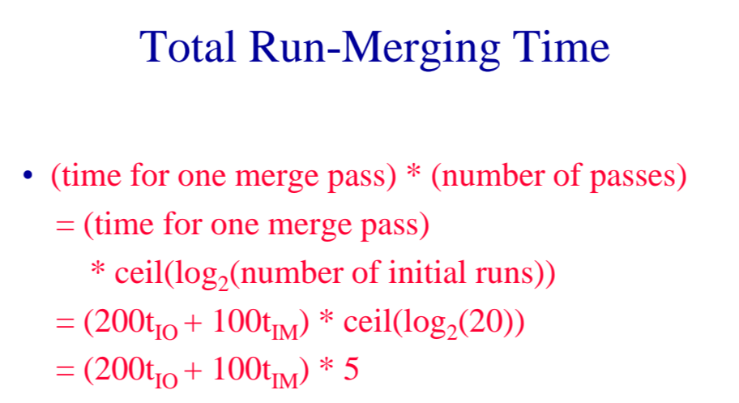


The ==complete external merge-sort time== for this example is:

$$
\begin{aligned}
T &= \text{run generation} + \text{run merging} \\
  &= (200t_{IO} + 20t_{IS})
     + 5(200t_{IO} + 100t_{IM}) \\
  &= 1200t_{IO} + 20t_{IS} + 500t_{IM}
\end{aligned}
$$


**Main factors affecting the running time**

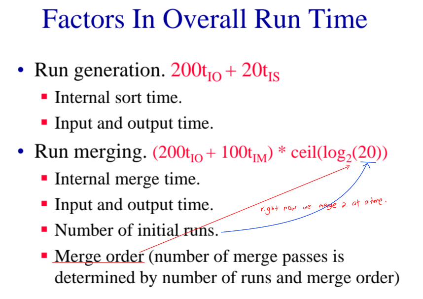 

---

### Improving the Merge Process

> [!IMPORTANT]
>
> **Improve run generation**
>
> - Overlap input, output, and internal sorting using multiple buffers.
> - Generate runs whose average length exceeds the memory size, reducing the number of initial runs. -> :runner: size of a run increase means number of runs will get reduce 100/5 vs 100/10
> - it will cause to reduce the number of parses as well.
>

> [!IMPORTANT]
>
> **Improve run merging**
>
> - Overlap input, output, and internal merging.
> - Use a higher-order merge to reduce the number of passes.
>
> For a $k$-way merge of $r$ initial runs:
>
> $$
> \text{number of passes} = \left\lceil \log_k r \right\rceil
> $$
>
> For example, merging 20 runs using a 5-way merge requires:
>
> $$
> \left\lceil \log_5 20 \right\rceil = 2 \text{ passes}
> $$
>
> 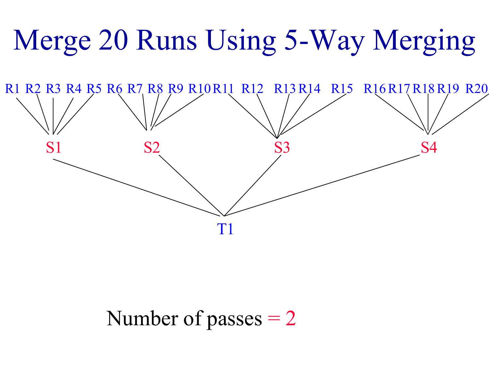
>
> *A 5-way merge reduces the same 20 runs to one run in only two passes.*
>
> **Trade-off when increasing the merge order**
>
> Increasing $k$ reduces the number of passes, but it does not make each pass free:
>
> - ==A $k$-way merge requires approximately $k$ input buffers.==
> - With a fixed amount of memory, a large $k$ makes each buffer smaller.
> - Smaller buffers cause more block reads and writes.
> - More block operations increase seek and latency overhead.
>
> Therefore, there is an optimal practical merge order; simply choosing the largest possible $k$ may increase total I/O time.
>
> 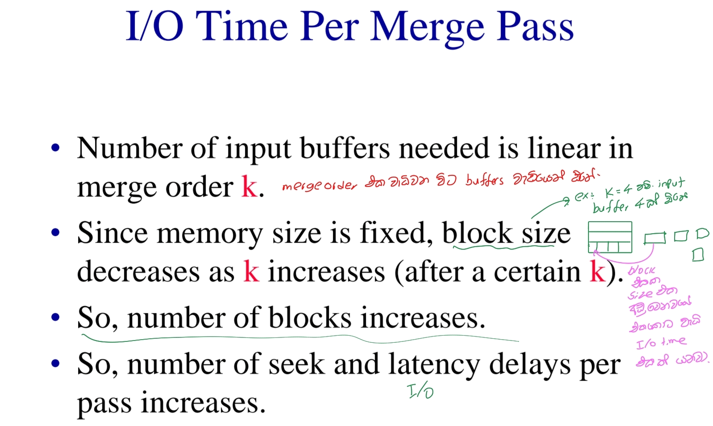
>
> 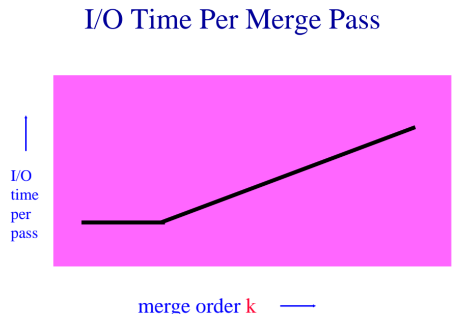 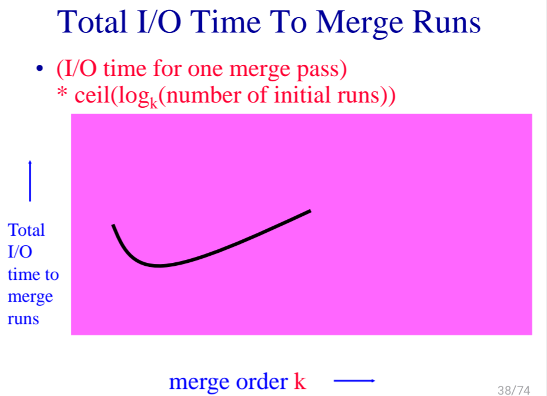

---

### Cost of a Naïve $k$-Way Merge

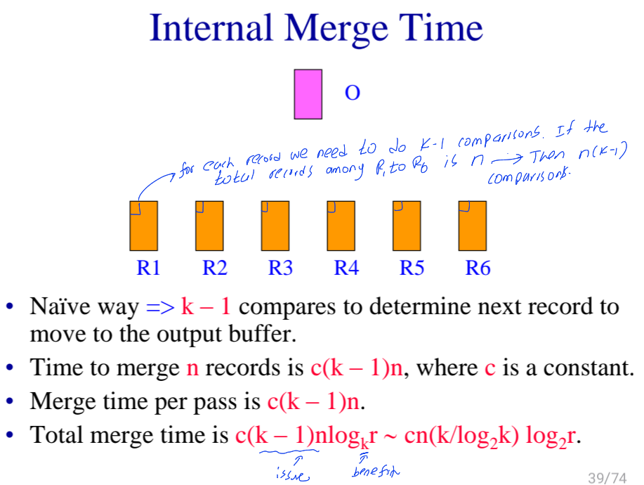

Suppose $k$ sorted runs are being merged.

With the naïve method, finding the smallest next record may require $k-1$ comparisons. For $n$ records:

$$
T_{\text{one pass}} = c(k-1)n
$$

where $c$ is a constant.

For $r$ initial runs, the total internal merge time is approximately:

$$
c(k-1)n\log_k r
\approx cn\left(\frac{k}{\log_2 k}\right)\log_2 r
$$

As $k$ becomes large, the work required to select the next record can become expensive. A tournament tree improves this selection step.

---

## 5. Tournament Trees

A tournament tree models a knockout competition. External nodes are the players, and internal nodes store match results.

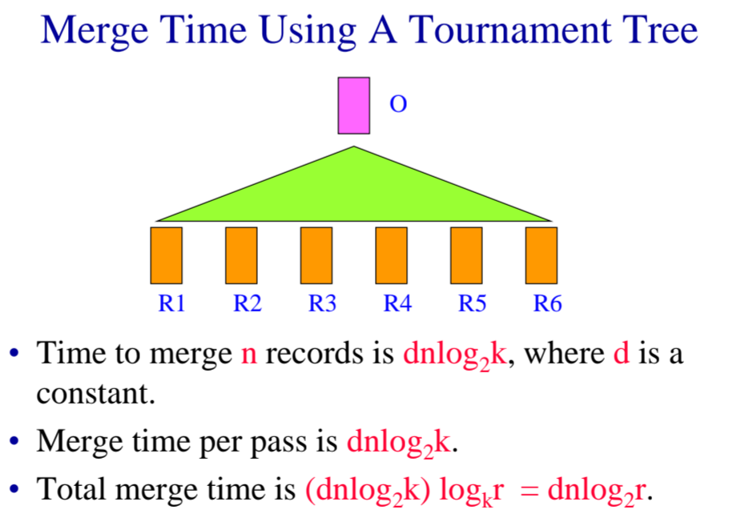

Tournament trees are mainly divided into:

- **Winner trees**
- **Loser trees**

**Winner tree**

A winner tree with $n$ players is a complete binary tree containing:

- $n$ external nodes representing players
- $n-1$ internal nodes representing matches

>  in a proper binary tree, the number of external nodes is exactly one more than the number of internal nodes
>
> A ***\*complete binary tree\**** is a special type of binary tree where ***\*every level is completely filled\****, except possibly the last level, which must have all its nodes ***\*filled from left to right\****.

Each internal node stores the winner of the match between its two children. The root stores the overall winner.

> In a **min winner tree**, the smaller value wins. In a **max winner tree**, the larger value wins.
>

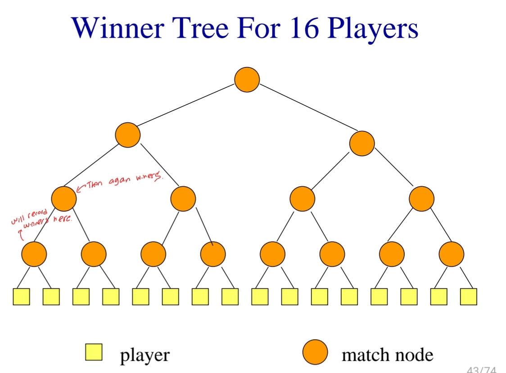

*A min winner tree stores each match winner; the smallest player value reaches the root.*


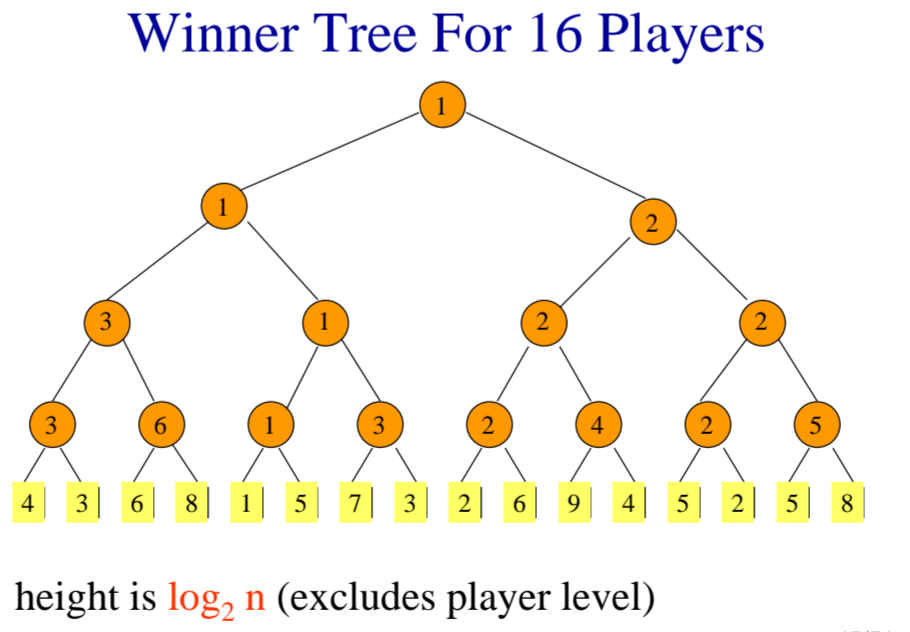

For $n$ players, the height of the match-node portion of the tree is:

$$
\log_2 n
$$

when $n$ is a power of two.


**Tie-breaking rule**

If two players have equal values, the player on the left wins. A consistent tie-breaking rule is important when the identity of the winning player must be preserved.


**Winner-tree operations**

| Operation | Complexity | Reason |
| --- | ---: | --- |
| Initialize the tree | $O(n)$ | There are $n-1$ match nodes |
| Get the winner | $O(1)$ | The winner is stored at the root |
| Replace the winner and replay | $\Theta(\log n)$ | One match is replayed at each level on the path to the root |

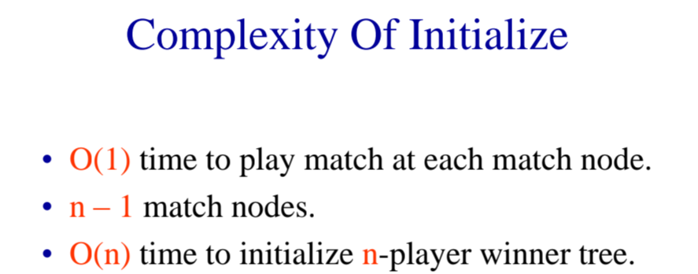 internal nodes hama ekakama match ekak thynw. O (1*(n-1) = O (n)


**Replace winner and replay**

After consuming the winning record:

1. Replace that player's value with its next value.
2. Replay only the matches along the path from that external node to the root.
3. At each match node, compare the updated winner with the opponent that previously lost there.

Only one root-to-leaf path changes, giving a replay time of $\Theta(\log n)$.

 `in naive algorithm it would take (k-1) comparisons for each n when comparing`


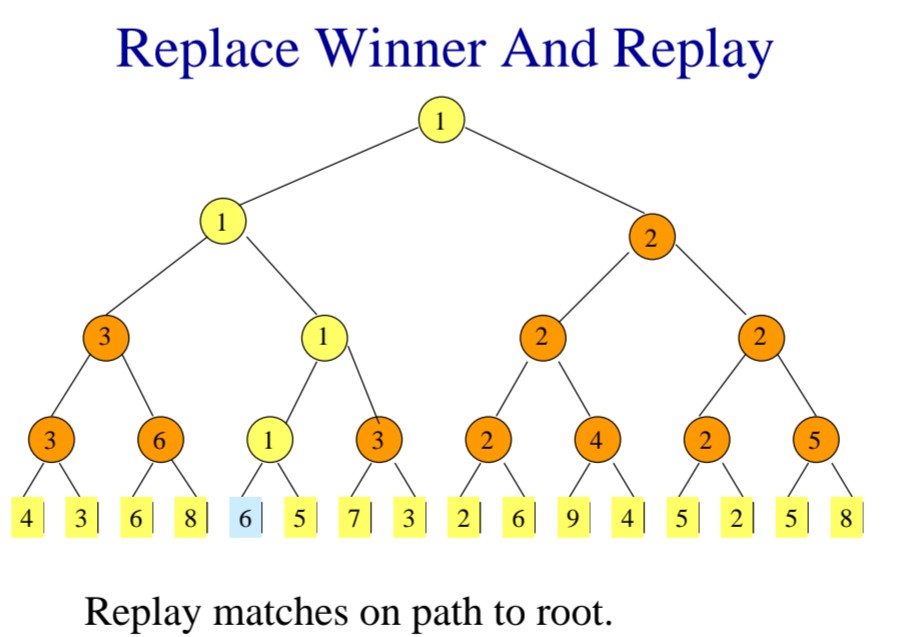 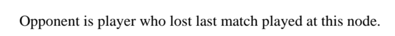

---

**Loser tree**

A **loser tree** stores the loser of each match at its internal node rather than the winner. The overall winner is stored separately.

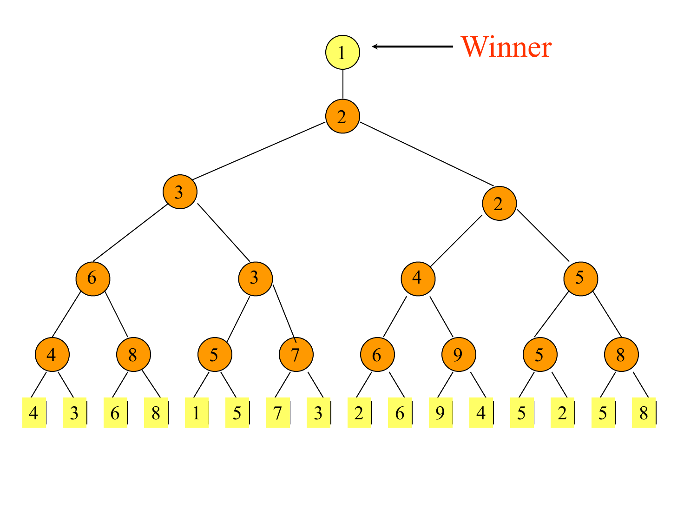

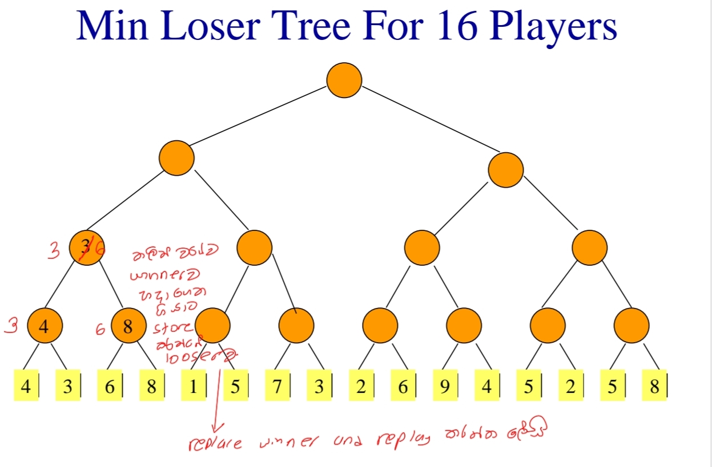

*The internal nodes retain match losers, while the overall winner is kept separately.*

<u>The main advantage during replay is that each internal node already identifies the previous opponent. After replacing the overall winner, it is compared with the stored losers along its path to the top.</u>

Like a winner tree:

- Initialization takes $O(n)$ time.
- Accessing the overall winner takes $O(1)$ time.
- Replacing the winner and replaying takes $\Theta(\log n)$ time.

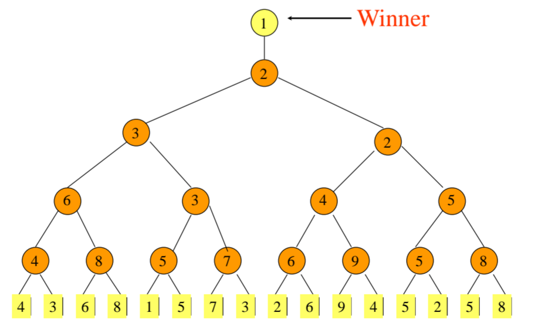 


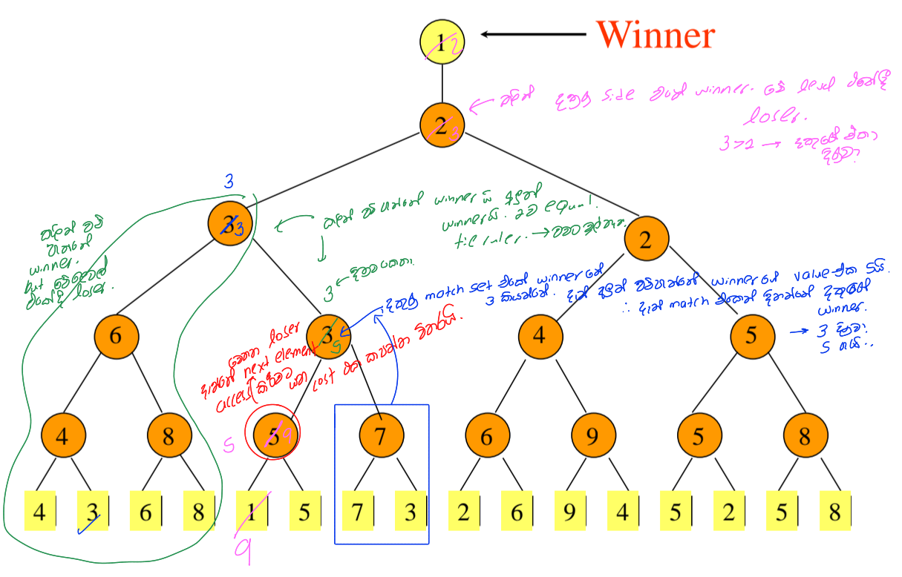


We need to have another variable to keep where does each winner came from.


**Winner tree vs. loser tree**

| Feature | Winner tree | Loser tree |
| --- | --- | --- |
| Internal node stores | Match winner | Match loser |
| Overall winner | At the root | Stored separately |
| Replay path length | $\Theta(\log n)$ | $\Theta(\log n)$ |
| Useful replay information | Opponent must be obtained from the sibling/subtree | Previous opponent is stored directly |

---

### Using a Tournament Tree for $k$-Way Merging

Treat the current first record of each of the $k$ runs as a tournament player.

1. Build a min tournament tree using the $k$ candidate records.
2. The root identifies the smallest record, so move it to the output buffer.
3. Replace that record with the next record from the same run.
4. Replay the matches along one path to the root.
5. Continue until every run is exhausted.

Selecting each output record takes $O(\log k)$ time. Merging $n$ records therefore takes:

$$
T_{\text{one pass}} = dn\log_2 k
$$

For $r$ initial runs, the total internal merge time is:

$$
(dn\log_2 k)\log_k r
= dn\log_2 r
$$

Thus, a tournament tree avoids the naïve $k-1$ comparisons for every output record.


**Applications of tournament trees**

- *Run generation*
- $k$-way run merging in external merge sort
- Truck loading and bin-packing heuristics

*in next lecture*

> [!WARNING]
>
> Huffman Tree is not a tournament tree
>
> |                    | Huffman Tree                                        | Tournament Tree                       |
> | ------------------ | --------------------------------------------------- | ------------------------------------- |
> | **Purpose**        | Data compression / encoding                         | Finding min/max efficiently           |
> | **Leaves**         | Symbols with frequencies                            | Elements being compared               |
> | **Internal nodes** | Combined frequencies                                | Winner of comparisons                 |
> | **Construction**   | Repeatedly combine the **two smallest frequencies** | Pairwise comparisons between elements |
> | **Main use**       | Huffman coding                                      | Selection, sorting, k-way merging     |

---

## 6. Bin Packing and Truck Loading

**Truck-loading problem**

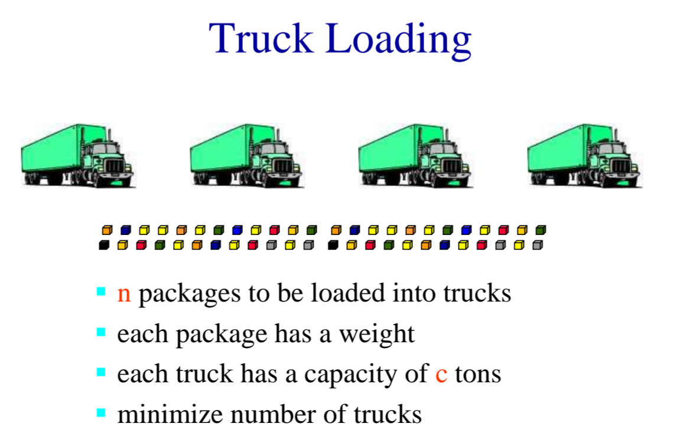

- There are $n$ packages.
- Each package has a weight.
- Each truck has capacity $c$.
- The goal is to use as few trucks as possible.

This is the same as the **bin-packing problem**:

- A truck corresponds to a bin.
- A package corresponds to an item.
- Weight corresponds to item size.
- Truck capacity corresponds to bin capacity.

Finding the minimum possible number of bins is **NP-hard** (in a polynomial time you can't solve it), so fast approximation heuristics are commonly used.

---

### Bin-Packing Heuristics

**First Fit (FF)**

Bins are kept in left-to-right order. Process items in the given order and place each item in the leftmost bin with sufficient remaining capacity. If no existing bin can hold it, open a new bin.

**First Fit Decreasing (FFD)**

1. Sort the items in decreasing order of size.
2. Apply First Fit.

**Best Fit (BF)**

For the current item, consider all bins with enough remaining capacity. Place the item in the bin that will have the least remaining capacity (highest filled one). If no bin can hold the item, open a new bin.

**Best Fit Decreasing (BFD)**

1. Sort the items in decreasing order of size.
2. Apply Best Fit.

**Comparison**

| Heuristic | Item order | Bin selected |
| --- | --- | --- |
| First Fit | Original order | Leftmost bin that can hold the item |
| First Fit Decreasing | Decreasing size | Leftmost bin that can hold the item |
| Best Fit | Original order | Feasible bin with the least available capacity |
| Best Fit Decreasing | Decreasing size | Feasible bin with the least available capacity |

**Performance guarantees from the lecture**

Let $OPT$ be the minimum possible number of bins.

For First Fit and Best Fit: around 70% more bins than minimum

$$
\text{bins used} \leq \frac{17}{10}OPT + 2
$$

For First Fit Decreasing and Best Fit Decreasing: around 20% more than the minimum

$$
\text{bins used} \leq \frac{11}{9}OPT + 4
$$

Sorting the items first therefore gives a stronger worst-case guarantee.

---

### Using a Max Winner Tree for First Fit

A max winner tree can store the remaining capacities of the bins.

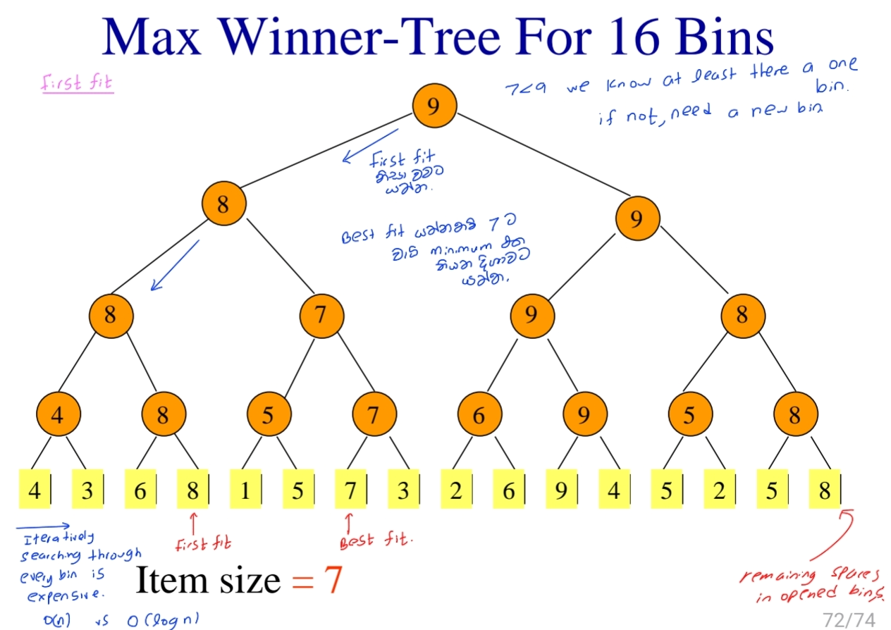

*The root records the largest remaining capacity; the example searches for a bin that can hold an item of size 7.*

For an item of size $s$:

1. If the root value is less than $s$, no existing bin has enough capacity, so open a new bin.
2. Otherwise, descend the tree to find the leftmost bin that can hold the item:
   - Choose the left subtree if its maximum remaining capacity is at least $s$.
   - Otherwise, choose the right subtree.
3. Subtract $s$ from the selected bin's remaining capacity.
4. Replay the matches from that bin to the root.

The tree supports both finding a suitable bin and updating its remaining capacity in $O(\log n)$ time.

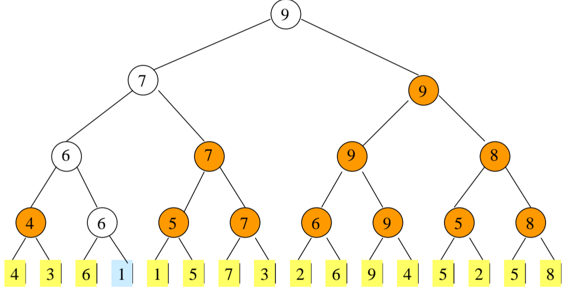

---

## 7. Quick Revision

**Complexity summary**

| Task | Time complexity |
| --- | ---: |
| Generate one internal-memory run of $m$ records | Depends on the internal sort, commonly $O(m\log m)$ |
| Number of $k$-way merge passes for $r$ runs | $\lceil\log_k r\rceil$ |
| Initialize a tournament tree with $k$ players | $O(k)$ |
| Read the tournament winner | $O(1)$ |
| Replace winner and replay | $\Theta(\log k)$ |
| Merge $n$ records with a tournament tree | $O(n\log k)$ per pass |
| First-Fit search/update using a max winner tree | $O(\log n)$ per item |

---

**Key takeaways**

1. External sorting is necessary when the complete data set cannot fit into main memory.
2. Disk I/O is far more expensive than internal computation, so external algorithms process data in blocks and use buffering.
3. External merge sort consists of run generation followed by repeated run-merging passes.
4. Increasing the merge order reduces the number of passes but increases buffer pressure and may increase I/O per pass.
5. A tournament tree finds the next record in a $k$-way merge in $O(\log k)$ time instead of scanning all $k$ candidates.
6. Winner and loser trees support $O(1)$ winner access and $\Theta(\log n)$ replacement.
7. Bin packing is NP-hard, so heuristics such as First Fit, Best Fit, and their decreasing variants are used in practice.

---

## 8. References

- E. Horowitz, S. Sahni, and D. Mehta, *Fundamentals of Data Structures in C++*, 2nd ed., Silicon Press, 2007.
- Lecture slides of Prof. Sartaj Sahni.
