# Lecture 03 — Double-Ended Priority Queues and Interval Heaps

[Heap Data Structure](<./sample from a previous module/3.Heap Data Structure.md>)

## 1. Lecture Map

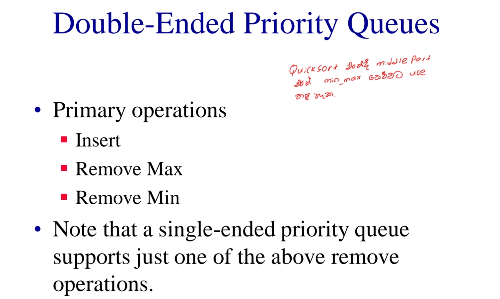

A normal priority queue gives efficient access to only one extreme: either the minimum or the maximum. A **double-ended priority queue (DEPQ)** supports both extremes efficiently.

> **Lecture flow:** define DEPQ operations → examine dual and correspondence-based implementations → develop interval heaps → analyze insertion, deletion, and initialization → improve cache behavior with $d$-ary heaps → apply interval heaps to complementary range searching.

The primary DEPQ operations are:

- `insert(x)`
- `getMin()` and `removeMin()`
- `getMax()` and `removeMax()`

Common specialized DEPQ structures include symmetric min-max heaps, min-max heaps, deaps, and **interval heaps**. This lecture concentrates mainly on interval heaps.

---

## 2. General DEPQ Constructions

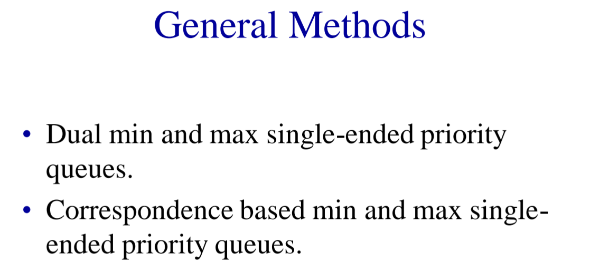 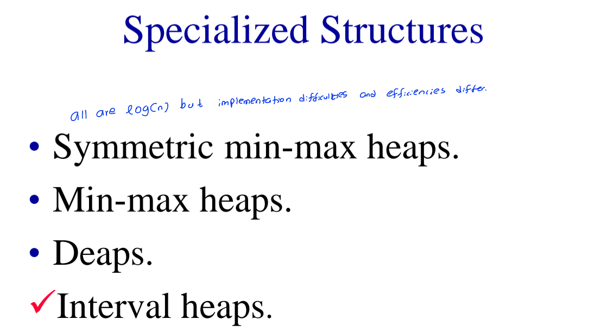


A DEPQ can be built from ordinary single-ended priority queues in two general ways:

1. **Dual structure:** store every element in both a min priority queue and a max priority queue.
2. **Correspondence structure:** divide the elements between a min priority queue and a max priority queue, then pair related elements.

####  **1. Dual min and max priority queues**

Every element is stored twice: once in a min heap and once in a max heap. The two copies are connected by two-way pointers.


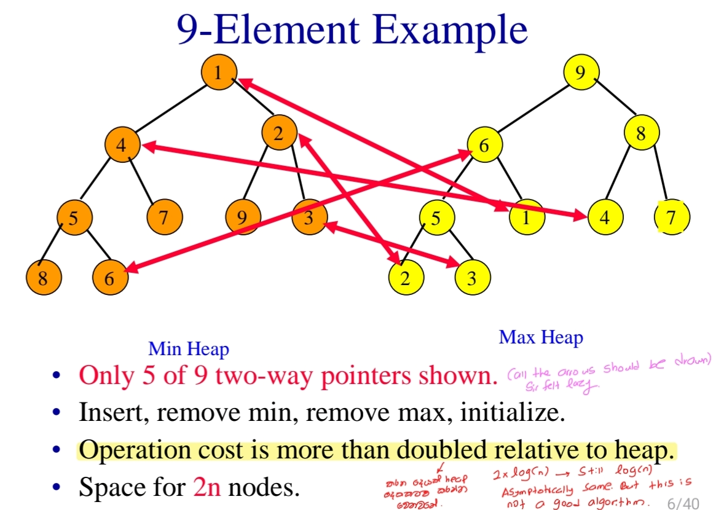

Operations work as follows:

- **Insert:** insert the element into both heaps and connect the copies.
- **Remove minimum:** remove the min-heap root, follow its pointer, and remove the corresponding node from the max heap.
- **Remove maximum:** perform the symmetric operation starting from the max-heap root.

Removing the corresponding copy means each underlying heap must support removal from an arbitrary known location, followed by heap repair.

| Property | Dual-heap result |
| --- | --- |
| Minimum access | $O(1)$ |
| Maximum access | $O(1)$ |
| Insert | $O(\log n)$, but performed in both heaps |
| Remove min/max | $O(\log n)$ in both heaps |
| Storage | $2n$ heap nodes plus cross-pointers |

The asymptotic operation time remains $O(\log n)$, but the constant cost is more than doubled and each element occupies two nodes.

#### **2. Correspondence structures**

අනුරූපී

A correspondence structure avoids storing two copies of every element:

- The min priority queue holds approximately $n/2$ elements.
- The max priority queue holds approximately $n/2$ elements.
- If $n$ is odd, one element is held in a separate buffer.
- Every min-side element is paired with a max-side element.
- The underlying priority queues must still support removal from a known arbitrary position.

> Two variants are **total correspondence** and **leaf correspondence**. 
>
> Under **total correspondence**, each element $x$ in the min queue is paired with a distinct element $y$ in the max queue satisfying:
> $$
> x\leq y
> $$
> 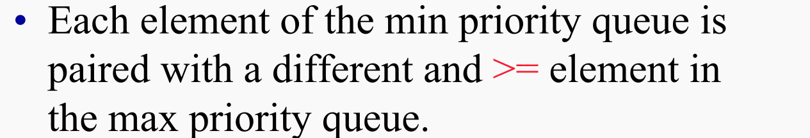


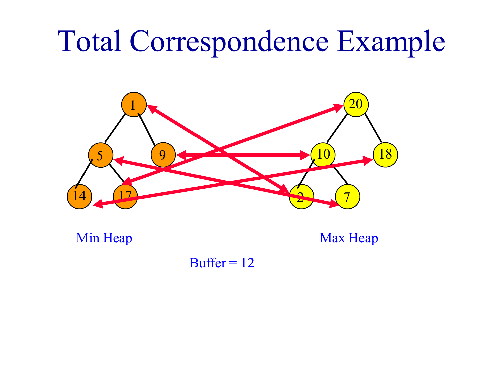

**Insertion under total correspondence**

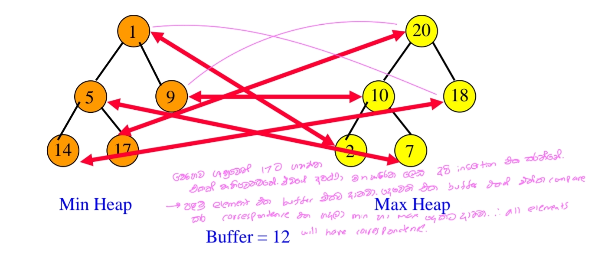

- If the buffer is empty, put the new element in the buffer.  
- Otherwise, compare the new element with the buffered element: (now buffered +1 , we have two elements can add to two heaps)
  - Insert the smaller one into the min priority queue.
  - Insert the larger one into the max priority queue.
  - Establish correspondence between them.
  - Empty the buffer.

**Removing the minimum**

1. Compare the buffer, when present, with the min-queue root.
2. If the buffer is the minimum, remove it and empty the buffer.
3. Otherwise, remove the min-queue root and its corresponding max-side element.
4. Reinsert the corresponding element through the normal insertion procedure. This restores the correct queue sizes, buffer state, and correspondence. (if buffer already have a value we can insert both or else we can put the element in the buffer)

Removing the maximum is symmetric.

> *Correspondence uses only $n$ element slots*, but maintaining pair relationships and arbitrary removal still makes the implementation relatively complicated. Interval heaps combine the two orderings more directly.
>
> This is better than dual min and max priority queues, but still this is not efficient.

---

Better Structures. But not in asymptotic notations, but in real life.

## 3. Interval-Heap Structure

An **interval heap** is a *complete binary tree* in which *each node contains one or two elements*.

- Every node except possibly the last contains two elements.
- The last node contains either one or two elements.
- If a node contains a  and b , they are ordered so that $a\leq b$.
- The node represents the closed interval $[a,b]$.
- A singleton node containing only $a$ represents $[a,a]$.

For intervals $[a,b]$ and $[c,d]$, the second is contained in the first when:

$$
[c,d]\subseteq[a,b]
\quad\Longleftrightarrow\quad
a\leq c\leq d\leq b
$$

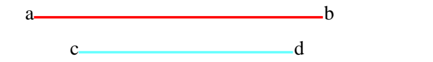

The defining interval-heap invariant is:

> Every non-root node's interval is contained in its parent's interval.

Therefore, if a parent is $[a,b]$ and a child is $[c,d]$:

$$
a\leq c
\qquad\text{and}\qquad
d\leq b
$$

This creates two simultaneous heaps:

- All **left endpoints** form a min heap.
- All **right endpoints** form a max heap.

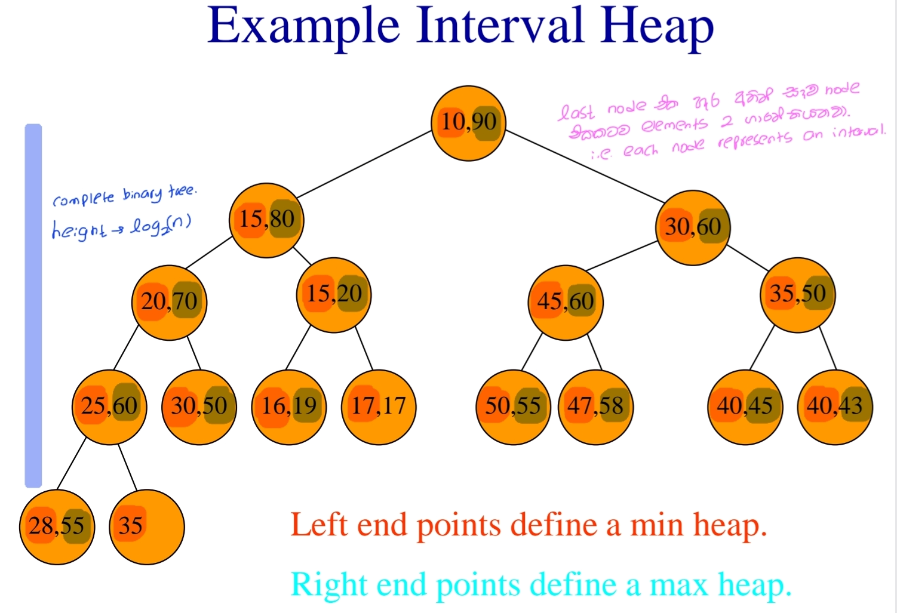

The root interval contains every other interval, so:

- The root's left endpoint is the global minimum.
- The root's right endpoint is the global maximum.

An interval heap containing $n$ elements has:

$$
m=\left\lceil\frac{n}{2}\right\rceil
$$

tree nodes. Because the tree is complete, its height is $\Theta(\log n)$. It can be stored compactly as an array of endpoint pairs.

> q:question: so in interval heap if each node contains two elements, does height becomes log(n/2)?
>
> Yes. If an interval heap stores \(n\) elements, the number of tree nodes is:
>
> \[ m=\left\lceil\frac{n}{2}\right\rceil \]
>
> Since these nodes form a complete binary tree, its height—measured in edges—is:
>
> \[ h=\left\lfloor\log_2 m\right\rfloor =\left\lfloor\log_2\left\lceil\frac{n}{2}\right\rceil\right\rfloor \]
>
> For even \(n\):
>
> \[ \log_2\frac{n}{2}=\log_2n-1 \]
>
> So the interval heap is approximately one level shorter than a binary heap storing each element in a separate node.
>
> However, in asymptotic notation:
>
> \[ \Theta\left(\log\frac{n}{2}\right)=\Theta(\log n) \]
>
> That is why the lecture simply describes the height as approximately \(\log_2 n\), and operations remain \(O(\log n)\).
>
> For example, with 16 elements:
>
> ```
> Interval-heap nodes = 16/2 = 8
> Height = log₂8 = 3 edges
> ```
>
> A normal binary heap with 16 separate nodes has height:
>
> \[ \log_2 16=4 \]

**Three invariants to remember**

For every node $[a,b]$:

1. **Local order:** $a\leq b$.
2. **Min-heap order:** the left endpoint is no smaller than its parent's left endpoint.
3. **Max-heap order:** the right endpoint is no larger than its parent's right endpoint.

All update operations preserve these three conditions.

---

#### Operations

##### **Accessing the extremes**

Both extremes are stored at the root:

```text
minimum = root.left
maximum = root.right
```

Therefore, `getMin()` and `getMax()` take $O(1)$ time.

##### **Insertion**

The insertion logic depends on whether the last node is full.

**Case A — The last node has one element**

Suppose the last node currently represents $[y,y]$.

1. Add the new element $x$ to that node.
2. Locally order the pair as $[\min(x,y),\max(x,y)]$.
3. If $x<y$, the new element became the left endpoint, so repair the min heap by percolating along left endpoints.
4. If $x>y$, the new element became the right endpoint, so repair the max heap by percolating along right endpoints.

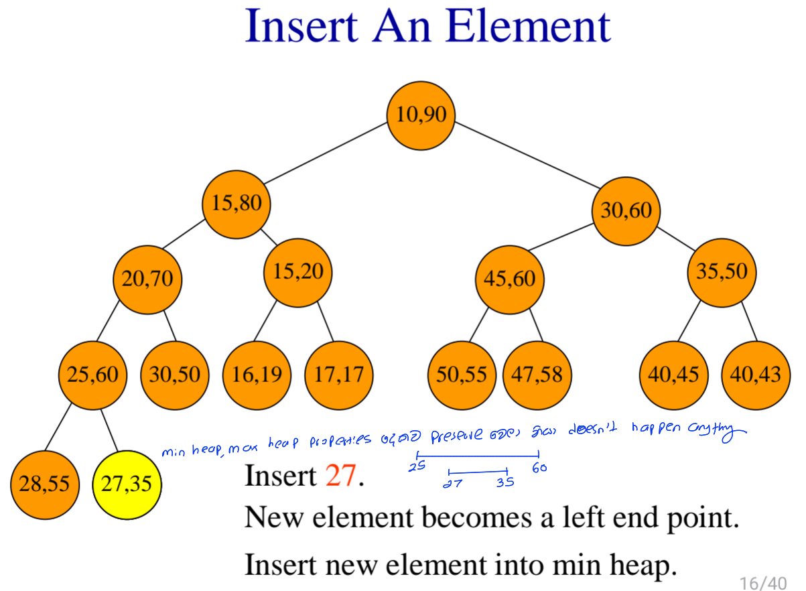

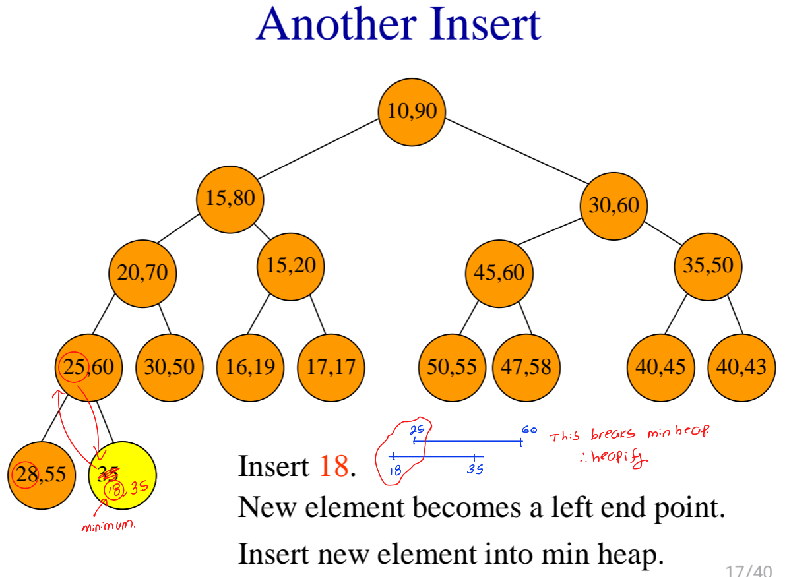

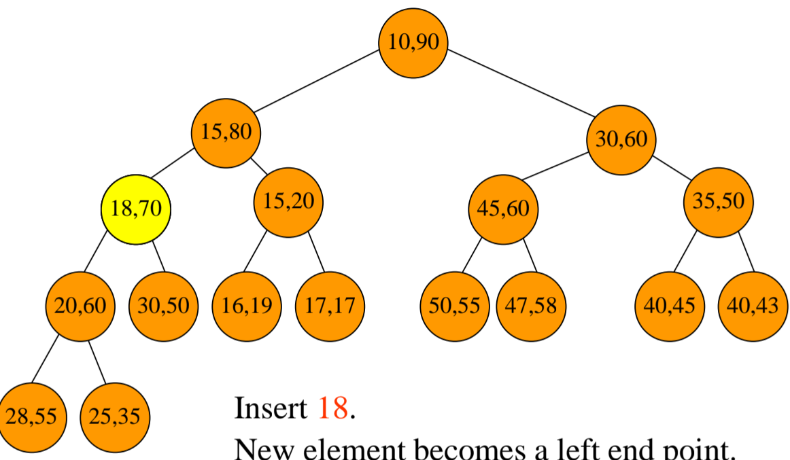

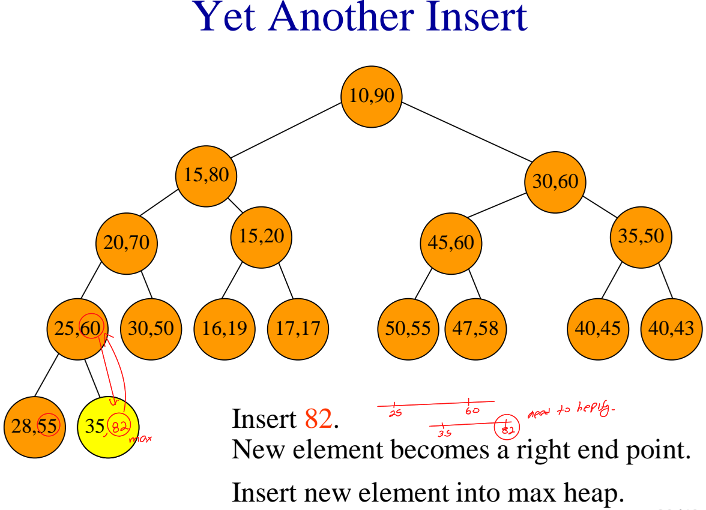

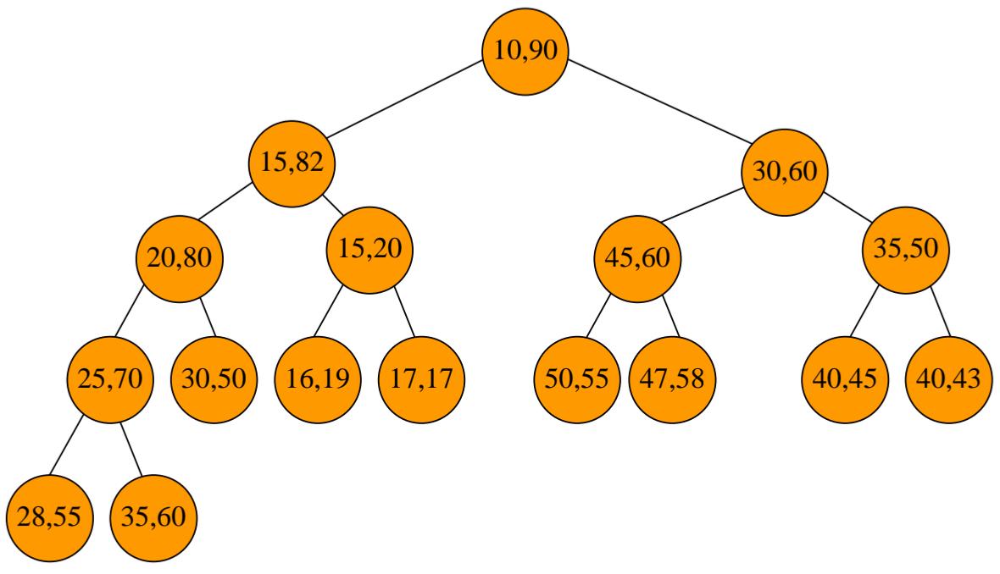

**Case B — The last node already has two elements**

Create a new singleton node $[x,x]$ in the next complete-tree position. Let the parent interval be $[a,b]$.

- If $x<a$, treat $x$ as a left endpoint and percolate it upward through the min heap.
- If $x>b$, treat $x$ as a right endpoint and percolate it upward through the max heap.
- If $a\leq x\leq b$, the new interval is already contained in its parent, so it stays in place.

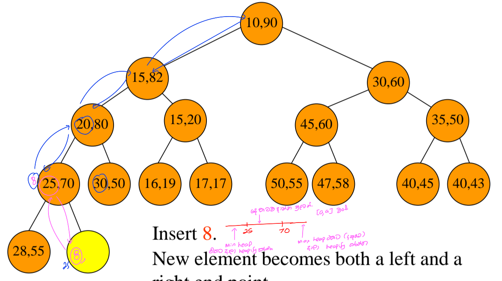

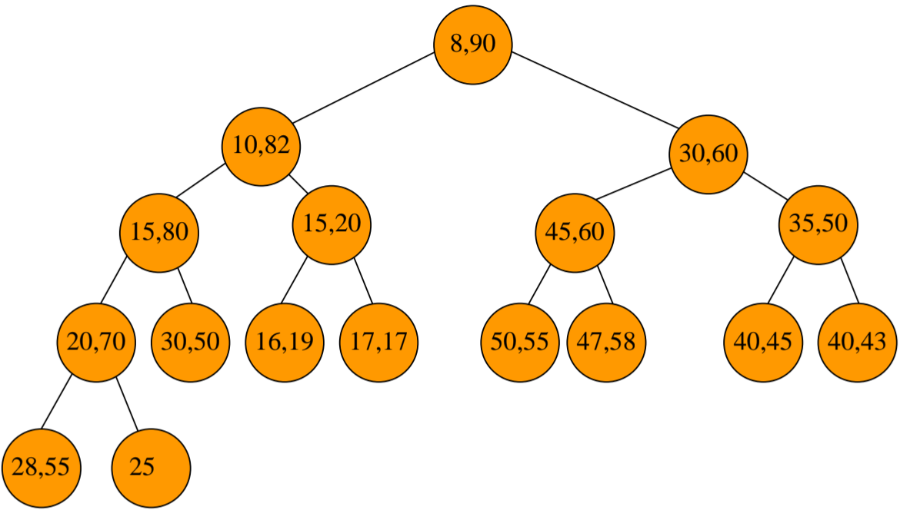

> During any endpoint movement, locally swap a node's endpoints when needed to retain `left <= right`.
>

Only one heap path is repaired, so insertion takes:

$$
O(\log n)
$$

##### **Removing the minimum**

Handle very small heaps directly:

- $n=0$: removal fails.
- $n=1$: (One node with one element) return the only element and make the heap empty.
- $n=2$: (one node with two elements) return the root's left endpoint; the right endpoint becomes a singleton.

For $n>2$:

1. Save and remove the root's left endpoint; this is the minimum.
2. Remove the left endpoint from the last node and use it as the replacement value.
3. Delete the last node if it becomes empty.
4. Starting at the root, compare the replacement with the left endpoints of the children.
5. Move the smaller child endpoint upward while it is smaller than the replacement.
6. Place the replacement in its final left-endpoint position.
7. If the replacement is greater than that node's right endpoint, swap the two endpoints to restore local order.

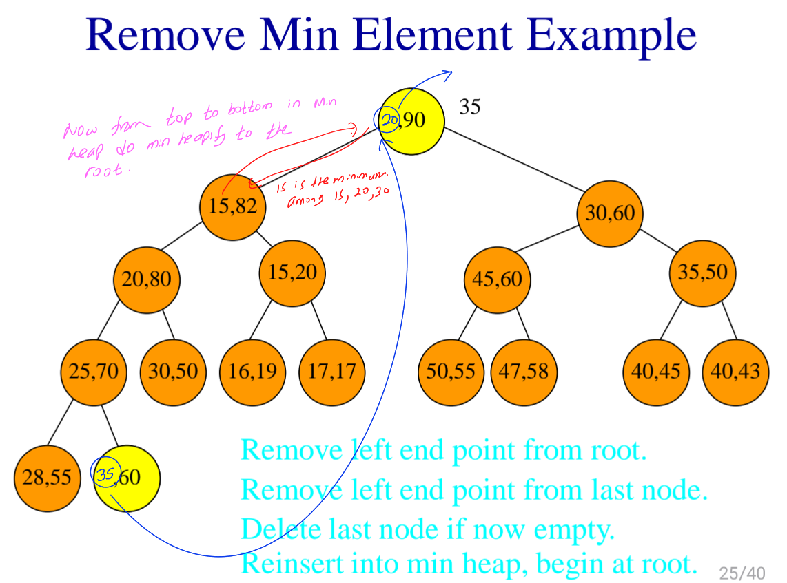

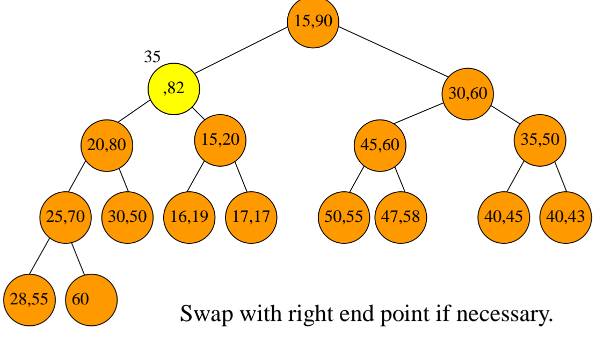

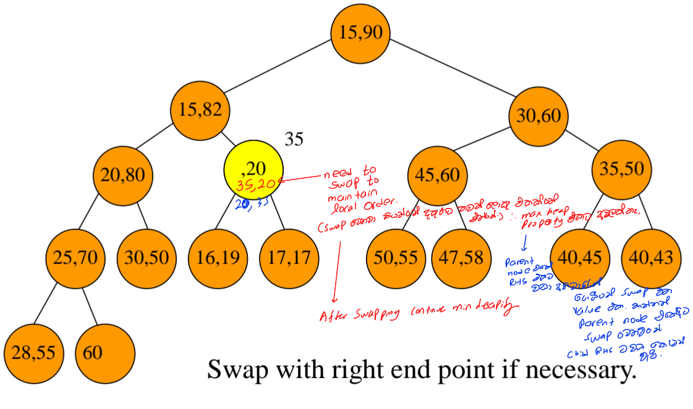

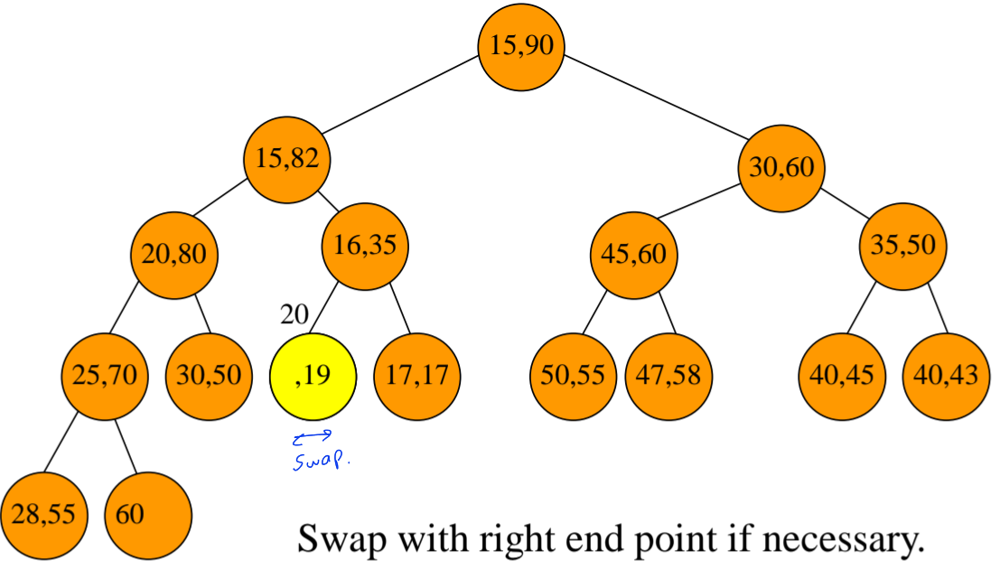

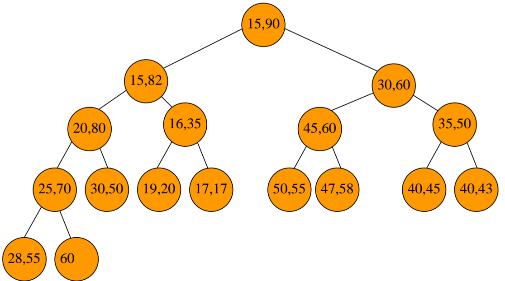

The replacement travels down at most the height of the tree, giving:

$$
O(\log n)
$$

##### **Removing the maximum**

The operation is symmetric:

1. Remove the root's right endpoint.
2. Take the right endpoint from the last node as the replacement.
3. Percolate it down through the max heap, choosing the child with the larger right endpoint.
4. Swap endpoints locally if necessary to maintain `left <= right`.

This also takes $O(\log n)$ time.

##### **Removing an element at a known location**

Replace the target with an endpoint taken from the last node, then repair the affected min-heap or max-heap path upward or downward. This takes $O(\log n)$.

##### **Initializing an interval heap**

An interval heap can be constructed bottom-up from an arbitrary array:

1. Group the elements into pairs, leaving one singleton if $n$ is odd.
2. Order every pair so its left endpoint is no greater than its right endpoint.

   [[2,4],[1,6],[3,9],[5,8],[2,6]]
3. Examine internal nodes from the bottom toward the root.

   Now Heapify
4. Repair each node's left endpoint in the min heap.
5. Repair each node's right endpoint in the max heap.
6. Whenever endpoints cross within a node, swap them.

Like bottom-up binary-heap construction, interval-heap initialization takes $O(n)$ time.


**Operation summary**

| Operation | Time |
| --- | ---: |
| Get minimum | $O(1)$ |
| Get maximum | $O(1)$ |
| Insert | $O(\log n)$ |
| Remove minimum | $O(\log n)$ |
| Remove maximum | $O(\log n)$ |
| Remove at a known location | $O(\log n)$ |
| Initialize from $n$ elements | $O(n)$ |
| Space | $O(n)$ |

---

## 4. Cache-Aware $d$-ARY Heaps

> [!IMPORTANT]
>
> In here we are talking about the normal Heap data Structure. An optimization for that, Can be used to interval- heap as well.

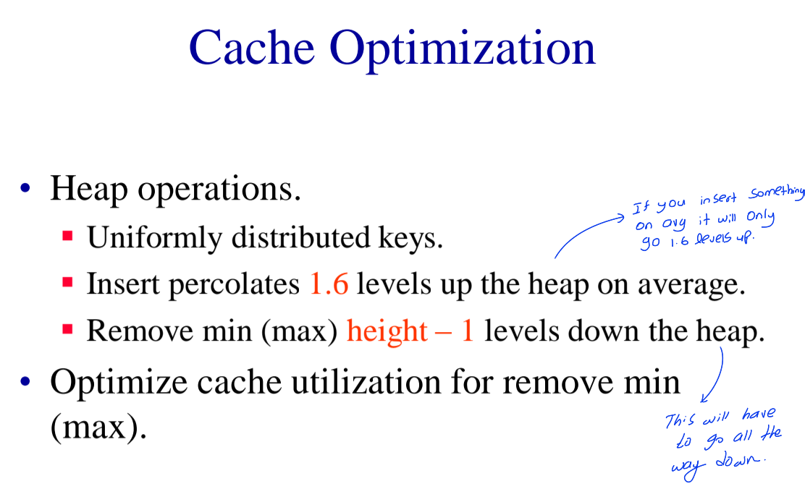

Asymptotic complexity does not capture all practical costs. Heap operations follow root-to-leaf paths, and poor cache locality can make each level expensive.

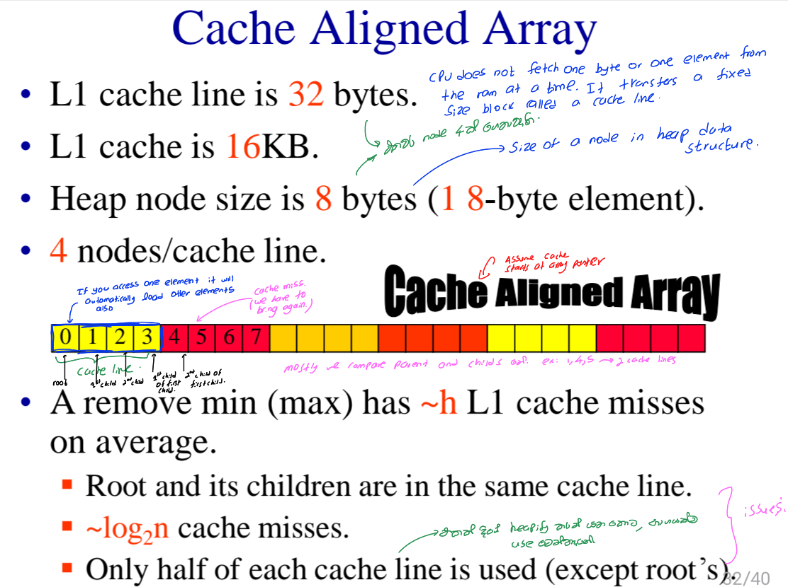


#### **D- ary Heap**

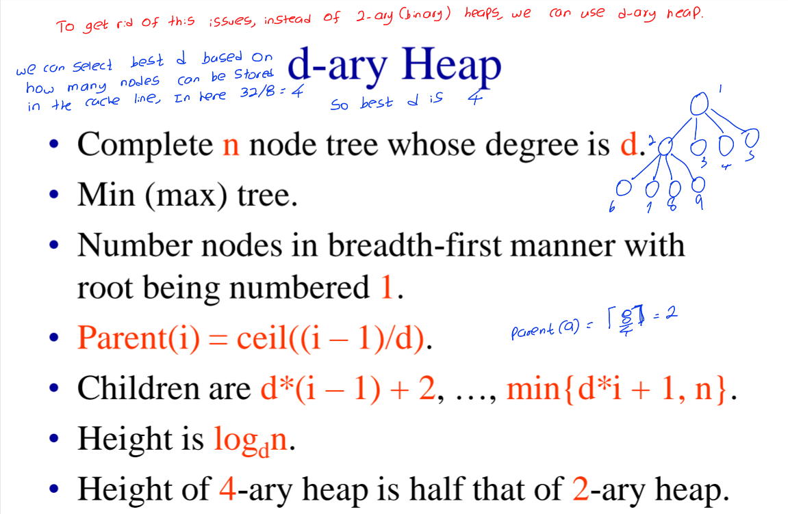

A $d$-ary heap is a complete heap in which each node has up to $d$ children. With nodes numbered from 1 in breadth-first order:

$$
\operatorname{parent}(i)
=\left\lceil\frac{i-1}{d}\right\rceil,
\qquad i>1
$$

The children of node $i$ have indices:

$$
d(i-1)+2,\ldots,\min(di+1,n)
$$

Its height is:

$$
\Theta(\log_d n)
$$

For a 4-heap:

$$
\log_4 n=\frac{1}{2}\log_2 n
$$

so it has about half as many levels as a binary heap.


**Trade-off in a 4-heap**

- Insertion has at most half as many upward levels as a binary heap.
- Removal must inspect four children per level rather than two.
- The number of levels, loop iterations, and element movements is roughly halved.
- The average insertion distance remains close to 1.6 levels for uniformly distributed keys.

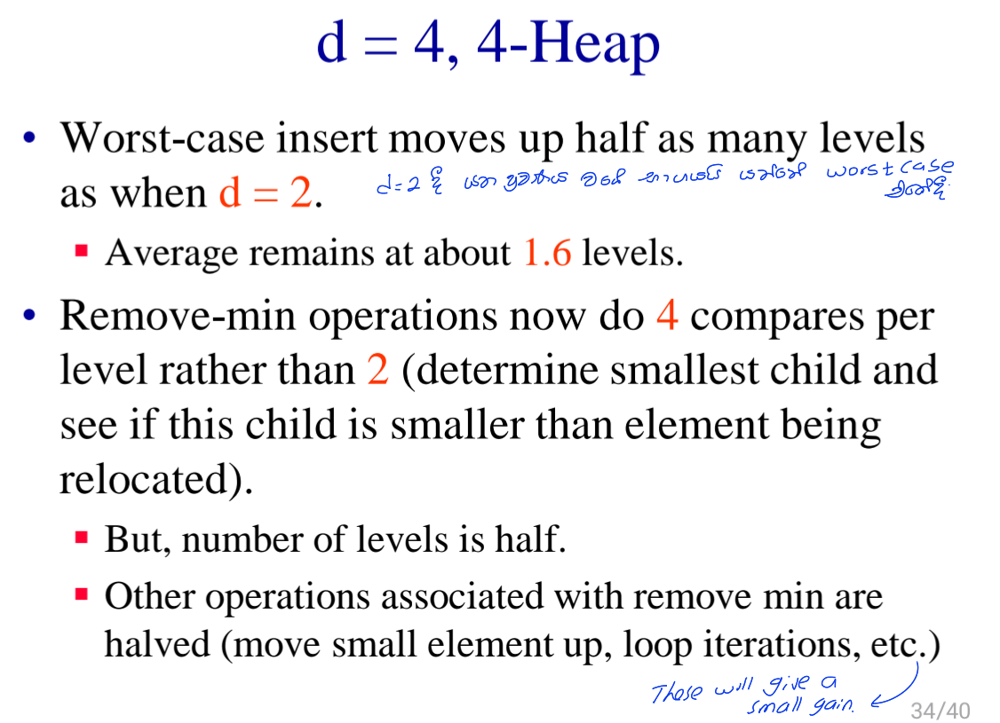

**Cache alignment**

With four 8-byte elements per 32-byte cache line, placing four siblings together allows all child comparisons to use one cache line. A standard array starting position may split the siblings across two lines. In the lecture's layout, shifting the 4-heap by two array slots aligns sibling groups.

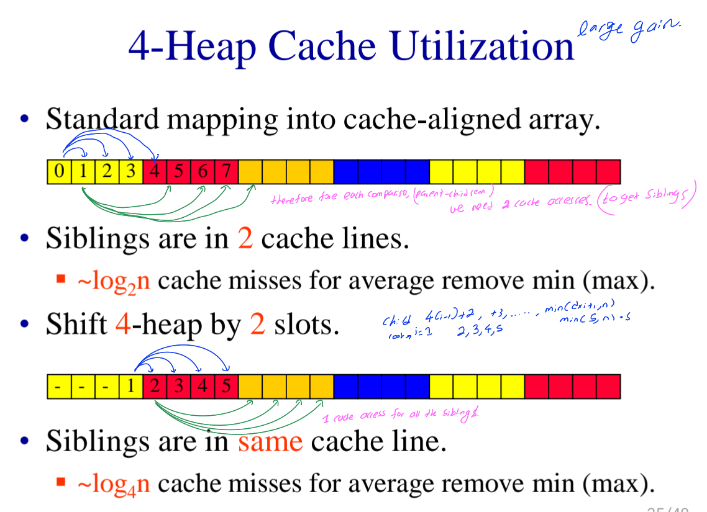

This reduces the approximate cache misses along a removal path from:

$$
\log_2 n
\quad\text{to}\quad
\log_4 n
$$

> The lecture reports a speedup of approximately 1.5 to 1.8 when heapsorting one million elements with a cache-aligned 4-heap instead of a binary heap beginning at array position zero.
>
> The same idea can be applied to interval heaps by using a complete degree-4 tree instead of a binary tree.
>

---

## 6. Applications of interval heap

#### Complementary range search

Given a collection of one-dimensional points and a query interval $[a,b]$, a **complementary range query** reports all points outside the interval:
$$
x<a
\quad\text{or}\quad
x>b
$$

An interval heap supports:

| Operation | Time |
| --- | ---: |
| Insert a point | $O(\log n)$ |
| Remove a point at a known location | $O(\log n)$ |
| Report all points outside $[a,b]$ | $O(k)$ |

Here, $k$ is the number of reported points.


**Why interval containment enables pruning**

Suppose the current node represents $[l,r]$.

- If $a\leq l\leq r\leq b$, the node interval lies entirely inside the query interval.
- Every descendant interval is contained in $[l,r]$.
- Therefore, the entire subtree is inside $[a,b]$ and can be skipped.

Otherwise:

- Report $l$ when $l<a$.
- Report $r$ when $r>b$; do not report it twice if the node is a singleton.
- Continue recursively into the children whose intervals may contain more outside points.

```python
reportOutside(node [l, r], query [a, b]):
    if node does not exist:
        return

    if a <= l and r <= b:
        return                    # whole subtree is inside the query

    if l < a:
        report l
    if r > b and r is a different stored element:
        report r

    reportOutside(left child,  [a, b])
    reportOutside(right child, [a, b])
```

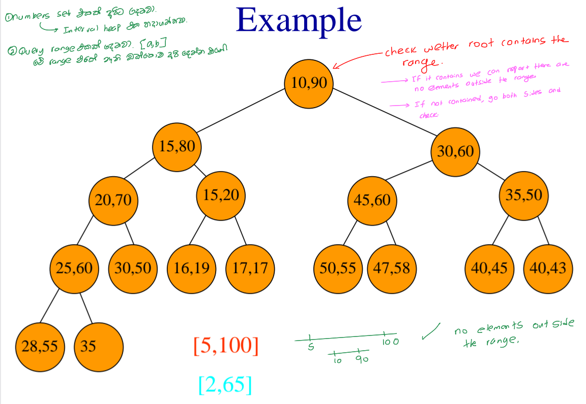

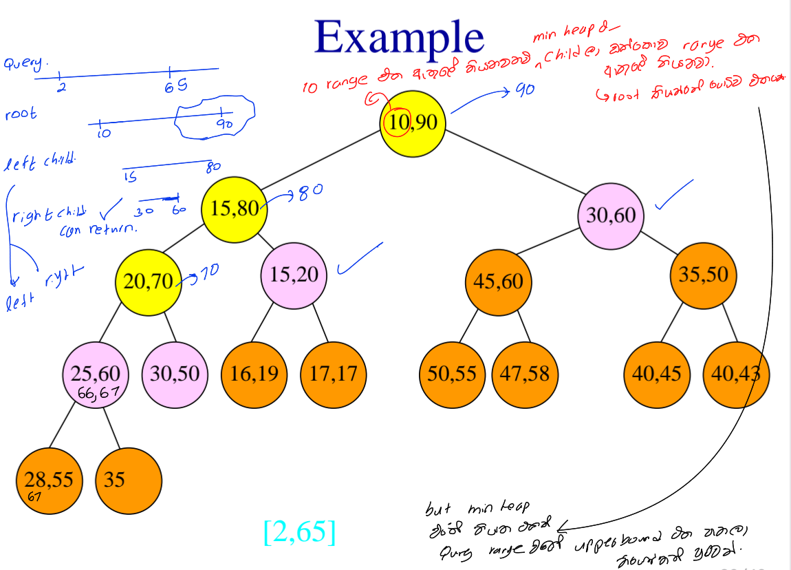

For the illustrated heap:

- Query `[5,100]` reports no points because the root interval `[10,90]` is already contained in the query.
- Query `[2,65]` reports `70`, `80`, and `90`.

Every expanded node has at least one endpoint outside the query, while fully contained subtrees are pruned immediately. Thus the traversal work is proportional to the number of reported points, giving $O(k)$ time.

-> Sometimes we have to go through whole tree, if a node sits inside the query range we do not need to go down through that tree. But it depends on whether range risides or not. Therefore the time complexity is not $O(log(n))$ , it is $O(k)$ where $k$ is the number of reported points.

---

## 7. Quick Revision

**Comparison of DEPQ approaches**

| Structure | Main idea | Main drawback |
| --- | --- | --- |
| Dual heaps | Store each element in both a min heap and max heap | $2n$ nodes and high constant update cost |
| Correspondence | Split elements between paired min and max heaps | Pair maintenance and arbitrary removal are complex |
| Interval heap | Store each node as a nested interval $[a,b]$ | Operations must preserve two heap orders and local endpoint order |

**Key facts**

1. A DEPQ supports insertion and efficient removal of both the minimum and maximum.
2. In an interval heap, left endpoints form a min heap and right endpoints form a max heap.
3. The root contains both the global minimum and global maximum.
4. Insertions repair either the min side or the max side, not both complete trees.
5. Removing an extreme replaces it using an endpoint from the last node and percolates down one side.
6. Interval-heap insertion and removal take $O(\log n)$, while initialization takes $O(n)$.
7. A 4-heap reduces height and can align sibling groups with cache lines.
8. Nested intervals allow complementary range queries to prune contained subtrees and run in $O(k)$ output-sensitive time.

---

## 8. References

- E. Horowitz, S. Sahni, and D. Mehta, *Fundamentals of Data Structures in C++*, 2nd ed., Silicon Press, 2007.
- Lecture slides of Prof. Sartaj Sahni.


