# Lecture 04 - Leftist Trees and Meldable Priority Queues

## 1. Lecture Map

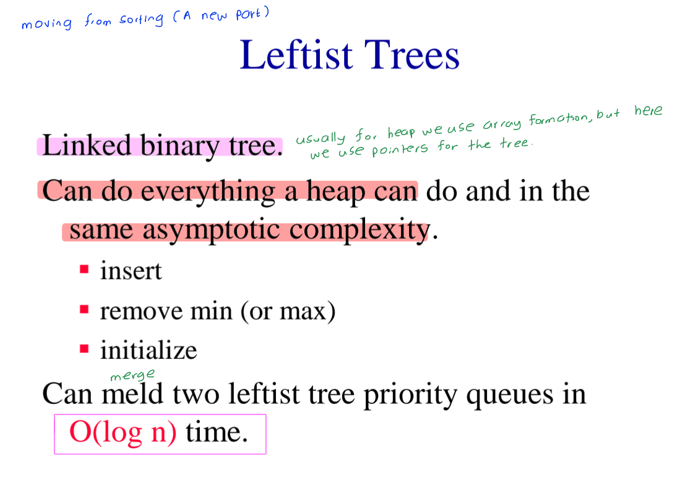

A binary heap supports efficient insertion and removal of the minimum, but efficiently combining two binary heaps is not one of its natural operations. A **leftist tree** is a linked priority-queue structure designed around an efficient `meld` operation.

> **Lecture flow:** convert a binary tree into an extended binary tree -> define the shortest-path value $s(x)$ -> impose the leftist property -> prove that the right spine is logarithmic -> implement meld -> build insertion, remove-min, initialization, and arbitrary removal from meld.

A leftist-tree priority queue supports:

- Insert
- Read and remove the minimum, or maximum in the max-oriented version
- Initialize from $n$ elements
- Meld two priority queues in logarithmic time

---

## 2. Extended Binary Trees and the Function $s(x)$

Start with an ordinary linked binary tree. Wherever a node has an empty left or right subtree, add a special **external node**. The result is an **extended binary tree**.

- Original data-holding nodes are called **internal nodes**.
- Added null-subtree markers are called **external nodes**.
- An extended tree with $n$ internal nodes has $n+1$ external nodes.

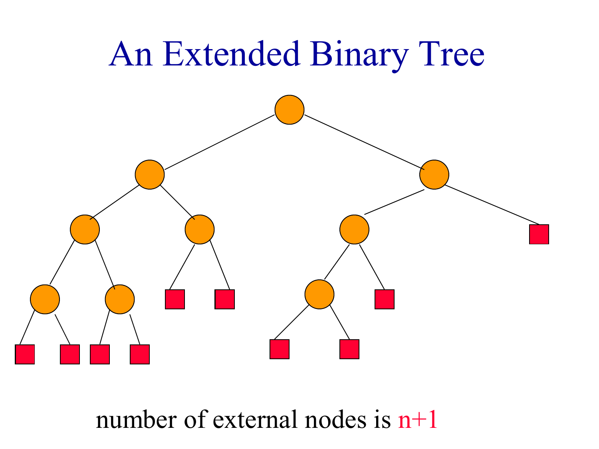

The $n+1$ result follows from counting child links. The $n$ internal nodes provide $2n$ child links. Exactly $n-1$ links connect internal nodes in the tree, leaving:

$$
2n-(n-1)=n+1
$$

empty links, which become external nodes.


### **null path length $s(x)$**

For any node $x$, let $s(x)$ be the length of the shortest path from $x$ to an external node in the subtree rooted at $x$.

Using the lecture's convention:

$$
s(x)=0
\qquad\text{if $x$ is external}
$$

For an internal node:

$$
s(x)=\min\left(s(x_{\text{left}}),s(x_{\text{right}})\right)+1
$$

> Bottom up approach will be easier because then we know the  $s(x_{\text{left}}),s(x_{\text{right}})$

Therefore:

- An external node has $s=0$.
- An internal leaf has two external children, so it has $s=1$.
- A larger $s$-value means every path from that node to an external node is longer.

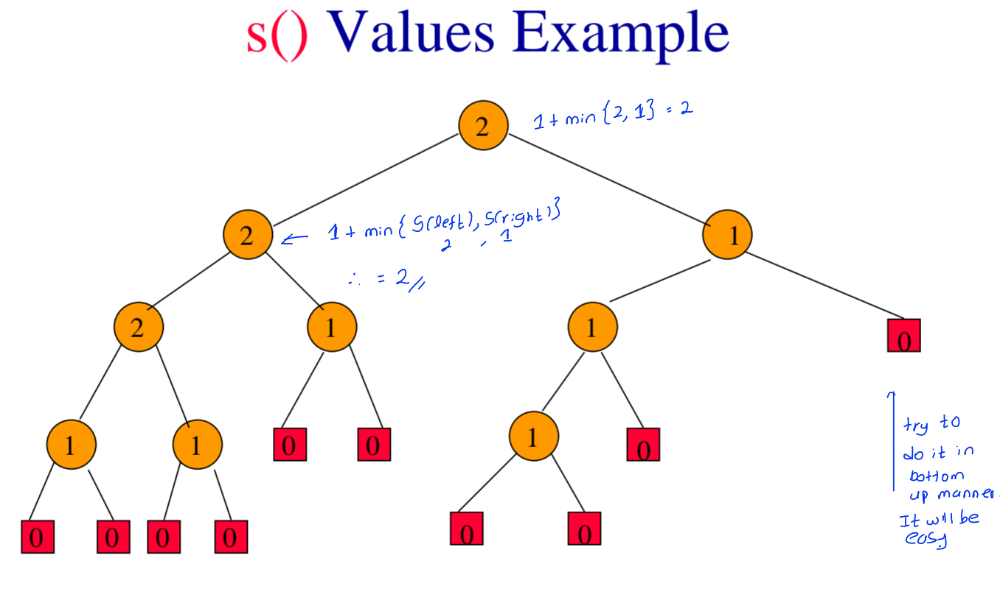

The value $s(x)$ is sometimes called the **null-path length**. Other textbooks may use a shifted convention, such as assigning $-1$ to a null child; all formulas in this note use the lecture convention where an external node has value 0.

---

## 3. Height-Biased Leftist Trees

A binary tree is a **height-biased leftist tree** when every internal node $x$ satisfies:

$$
s(x_{\text{left}})\geq s(x_{\text{right}})
$$

The left subtree is therefore at least as far from an external node as the right subtree. This does not make the entire tree height-balanced. It deliberately keeps the right side short, while the left side may be much deeper.


#### **Property 1 - The rightmost path is a shortest path**

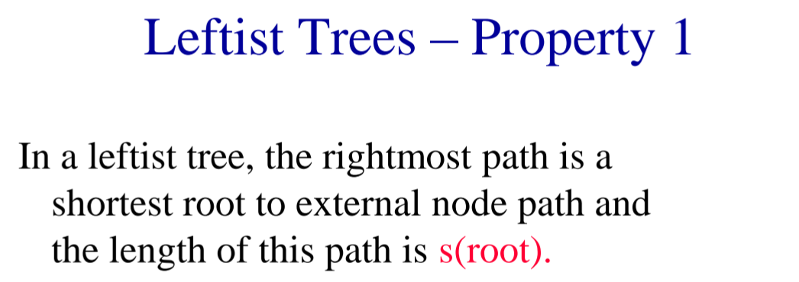

Because the right child always has the smaller or equal $s$-value:

$$
s(x)=s(x_{\text{right}})+1
$$

Following right-child links decreases $s$ by exactly 1 at every step until an external node with $s=0$ is reached. Therefore:

$$
\text{length of the rightmost path}=s(\text{root})
$$

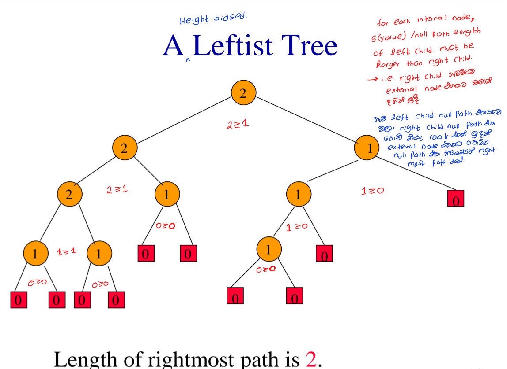


#### **Property 2 - A lower bound on the number of nodes**

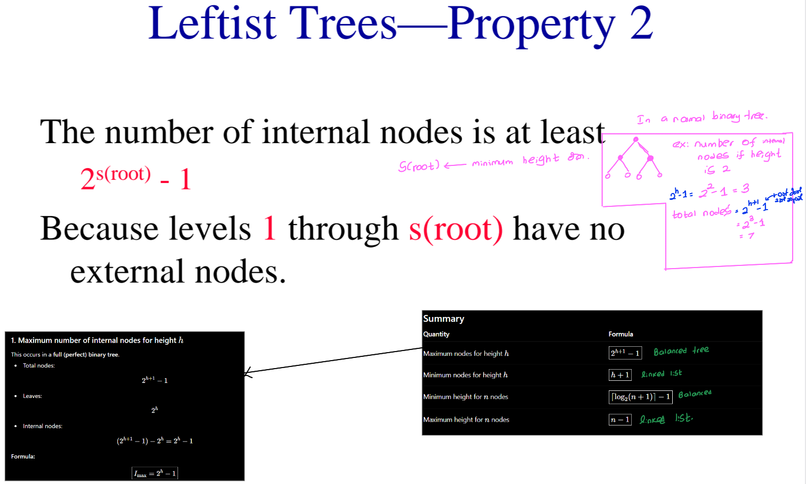

Let:

$$
r=s(\text{root})
$$

No external node can appear in the first $r$ internal levels; otherwise, the root would have a shorter path to an external node. Those levels contain at least:

$$
1+2+4+\cdots+2^{r-1}=2^r-1
$$

internal nodes. Hence, if the tree has $n$ internal nodes:

$$
n\geq2^{s(\text{root})}-1
$$

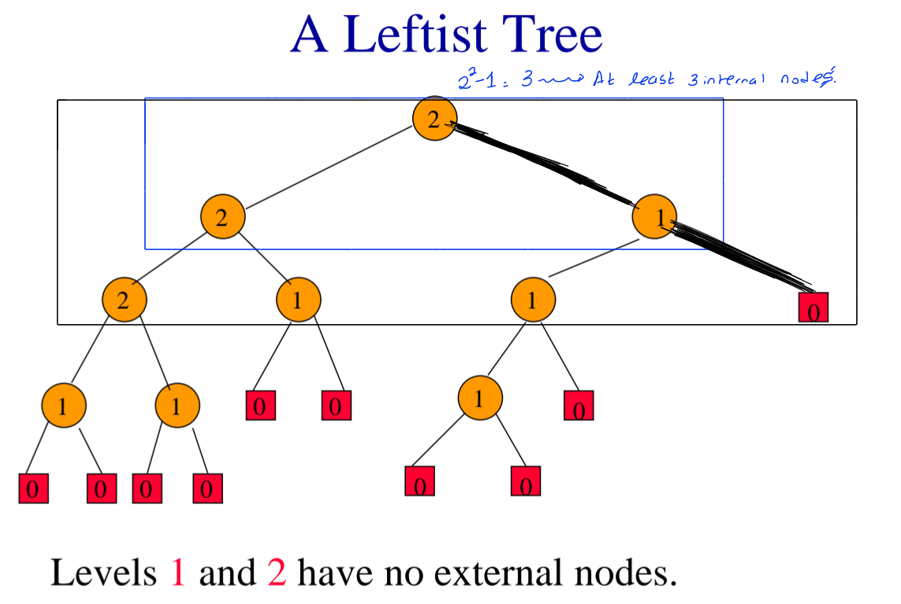


#### **Property 3 - The rightmost path is logarithmic**

Starting from the previous inequality:

$$
n\geq2^{s(\text{root})}-1
$$

Add 1 and take base-2 logarithms:

$$
n+1\geq2^{s(\text{root})}
$$

$$
s(\text{root})\leq\log_2(n+1)
$$

Since the rightmost path has length $s(\text{root})$:

$$
\text{rightmost-path length}=O(\log n)
$$

> The whole tree can still have height $O(n)$. <u>The logarithmic guarantee applies specifically to the right spine, which is the path used by meld.</u>

---

## 4. Leftist Trees as Priority Queues

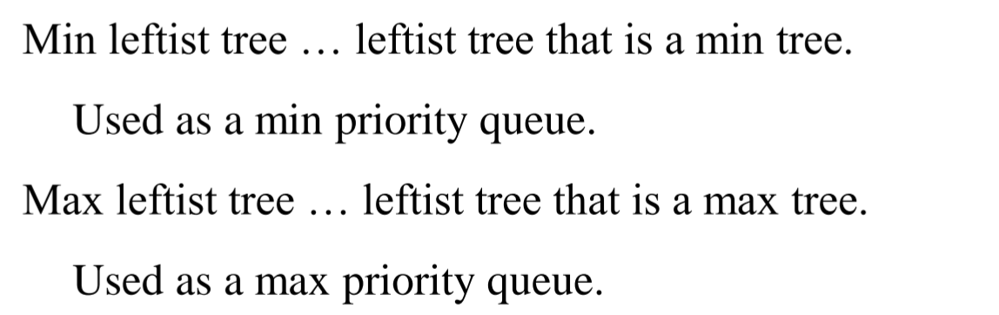

A **min leftist tree** satisfies two independent conditions:

1. **Min-tree order:** every node's key is no greater than the keys of its children.
2. **Leftist property:** $s(\text{left})\geq s(\text{right})$ at every internal node.

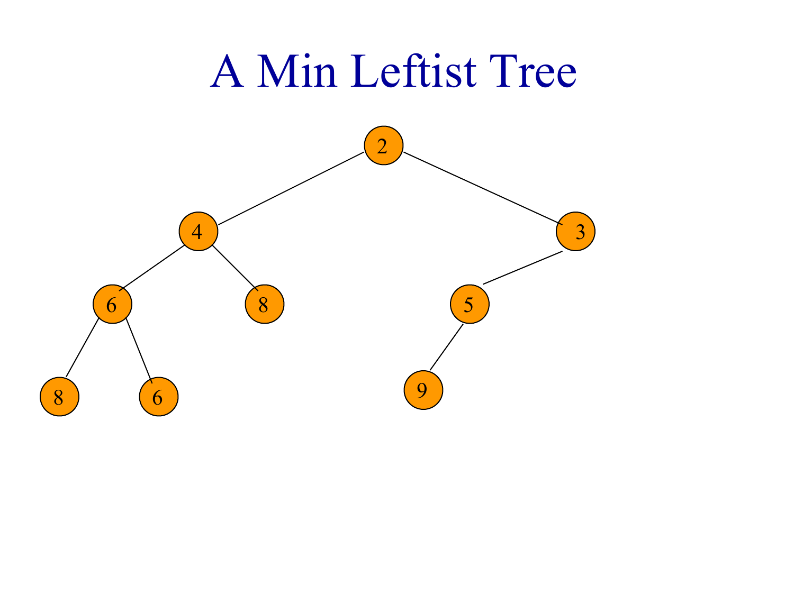

The minimum key is at the root, so reading it takes $O(1)$ time. A leftist tree is not a binary search tree: there is no ordering relationship between an entire left subtree and an entire right subtree.

A typical node stores:

```text
key
leftChild
rightChild
sValue
```

External nodes can be represented by `null` pointers with an implicit $s$-value of 0. An internal leaf then has $s=1$.

A **max leftist tree** reverses the priority order, placing the maximum key at the root, while keeping the same leftist property.

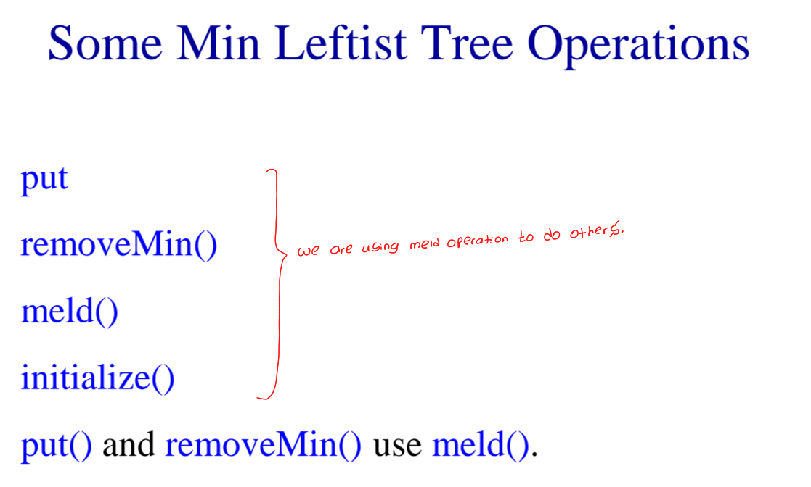

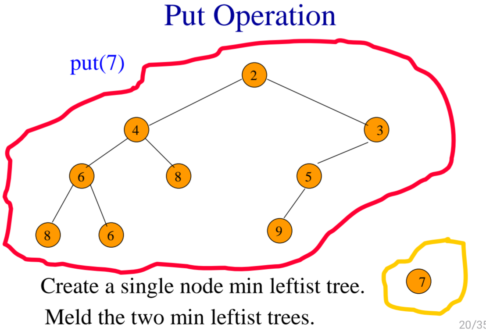 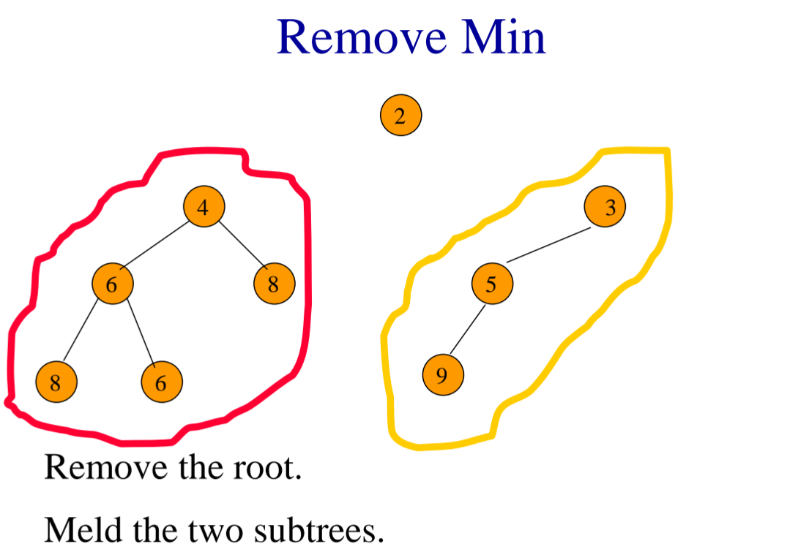

---

## 5. Melding Two Min Leftist Trees

`meld(H1,H2)` combines all elements from two min leftist trees into one min leftist tree.

The essential idea is:

1. Keep the smaller root as the root of the result.
2. Recursively meld the other tree with the right subtree of the smaller-root tree.
3. Attach the recursive result as the new right subtree.
4. Swap the left and right children if the leftist property is violated.
5. Recompute the root's $s$-value.

```c
// Meld (merge) two leftist heaps and return the resulting heap.
Node* meld(Node* H1, Node* H2) {

    // If the first heap is empty, return the second heap.
    if (H1 == nullptr)
        return H2;

    // If the second heap is empty, return the first heap.
    if (H2 == nullptr)
        return H1;

    // Ensure H1 has the smaller root (for a min-leftist heap).
    // If not, swap the two heaps.
    if (H2->key < H1->key)
        swap(H1, H2);

    // Recursively meld H2 with the right subtree of H1.
    H1->right = meld(H1->right, H2);

    // Maintain the leftist property:
    // The left child must have a null path length (s-value)
    // greater than or equal to the right child.
    if (s(H1->left) < s(H1->right))
        swap(H1->left, H1->right);

    // Update the s-value (null path length).
    // It is always 1 + the s-value of the right child.
    H1->s = s(H1->right) + 1;

    // Return the root of the merged heap.
    return H1;
}
```

The final assignment uses:

$$
s(H1)=s(H1_{\text{right}})+1
$$

because the leftist property guarantees that the right child has the smaller or equal $s$-value.


**Example from the lecture**

After removing the minimum root from the earlier priority queue, its two remaining subtrees have roots 4 and 3. The remove-min operation melds these two trees.

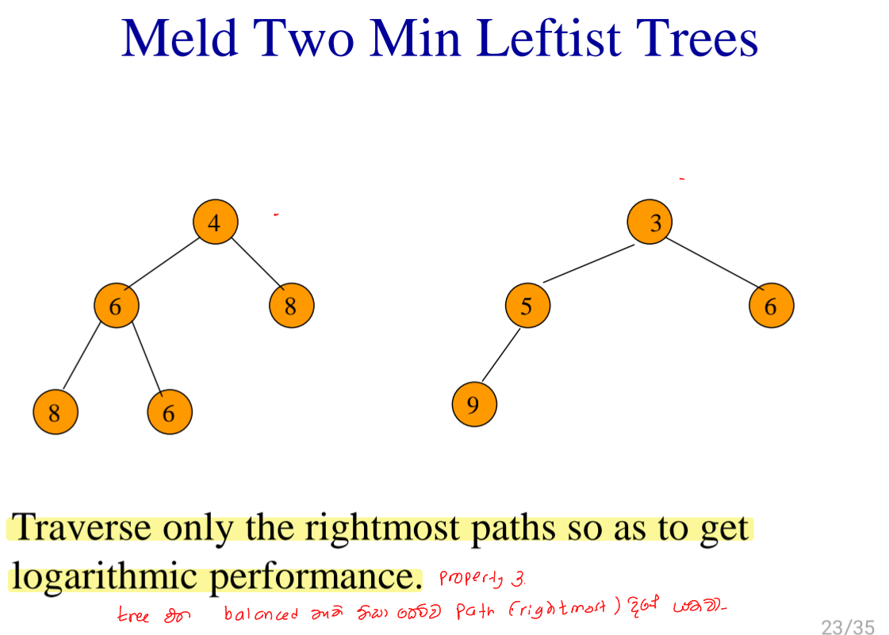

The algorithm keeps root 3 because $3<4$. It recursively melds the right subtree of the smaller-root tree with the other tree. When a recursive right subtree is empty, the other tree is returned directly. During recursion unwinding, the result is attached on the right, child subtrees are swapped where necessary, and $s$-values are updated.

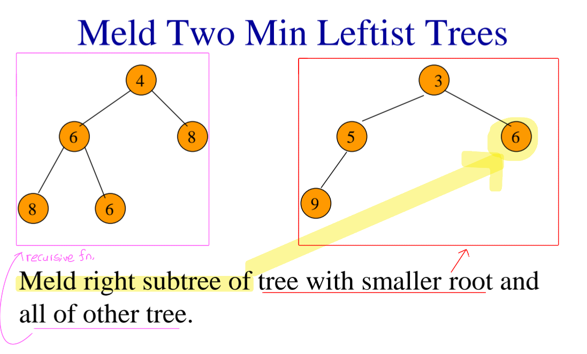
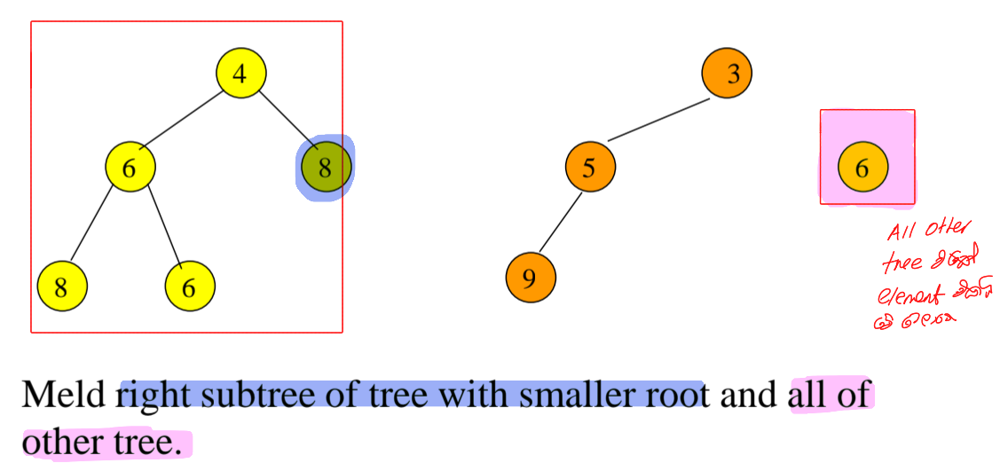

```c
// Ensure H1 has the smaller root (for a min-leftist heap).
// If not, swap the two heaps.
// H1 -> 6, H2->4
if (H2->key < H1->key)
        swap(H1, H2); //just swapping pointers

// Recursively meld H2 with the right subtree of H1.
H1->right = meld(H1->right, H2);

```

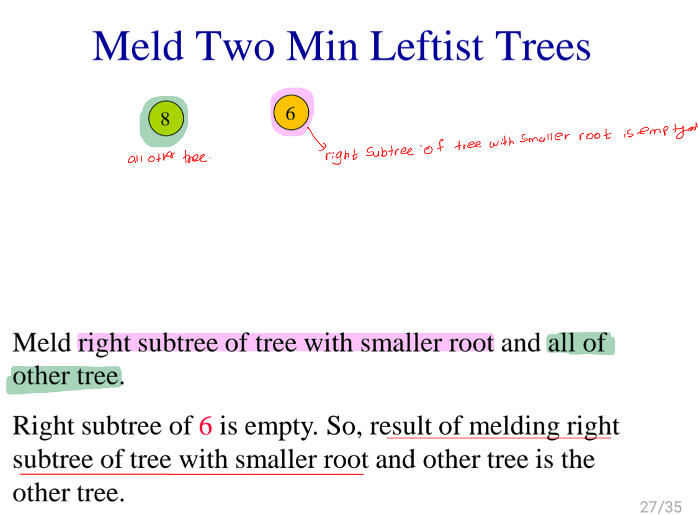

```c
// If the first heap is empty, return the second heap.
if (H1 == nullptr)
return H2;

// If the second heap is empty, return the first heap.
if (H2 == nullptr)
return H1;
```

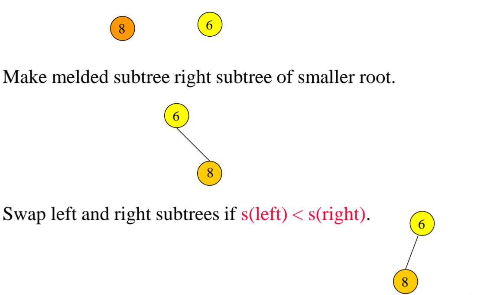
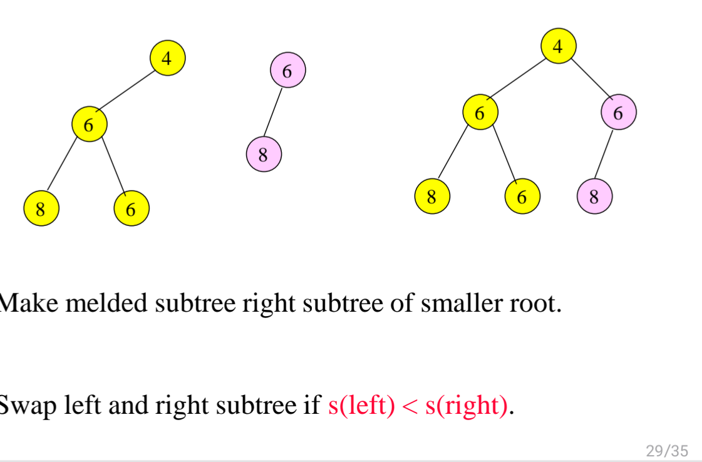
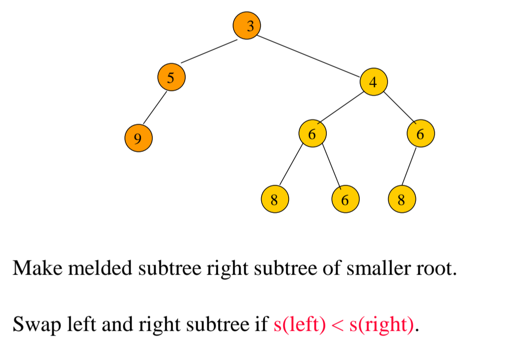
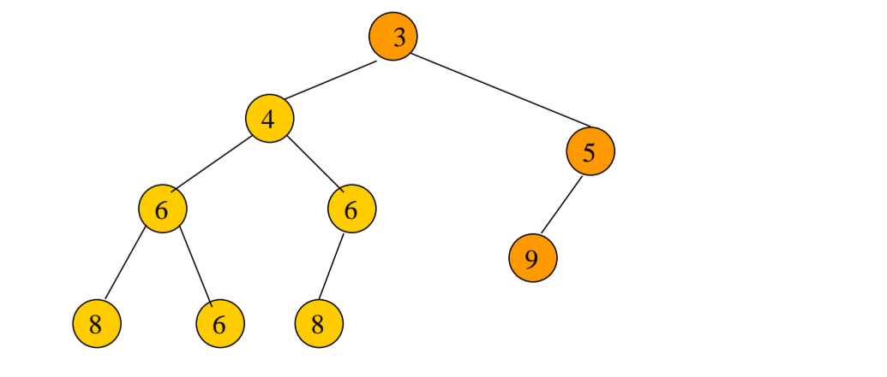

**Why meld is correct**

- The smaller of the two roots becomes the result root, preserving min-tree order.
- The recursive call preserves min-tree order within the combined right subtree.
- Swapping children does not break min-tree order because both children already have keys no smaller than their parent.
- The final swap and $s$ update restore the leftist property.

**Why meld takes logarithmic time**

Meld follows only right-child paths. A tree with $n_i$ nodes has a right spine of length at most $\log_2(n_i+1)$. Therefore, melding trees of sizes $n_1$ and $n_2$ takes:

$$
O(\log n_1+\log n_2)
=O(\log(n_1+n_2))
$$

The last equality is asymptotic: when both sizes are at most $n_1+n_2$, the sum is at most a constant multiple of $\log(n_1+n_2)$.

---

## 6. Priority-Queue Operations Built from Meld

Once `meld` is available, the main priority-queue operations are short.

**Insert**

To insert key $x$:

1. Create a one-node min leftist tree containing $x$.
2. Meld it with the existing priority queue.

```text
put(x):
    singleton = new node(x)
    root = meld(root, singleton)
```

Time complexity:

$$
O(\log n)
$$

**Remove minimum**

The root contains the minimum:

1. Save the root key.
2. Remove the root.
3. Meld its left and right subtrees.
4. Make the meld result the new root.

```text
removeMin():
    if root is empty:
        fail

    answer = root.key
    root = meld(root.left, root.right)
    return answer
```

Time complexity:

$$
O(\log n)
$$

**Initialize in linear time**

An $O(n)$ initialization uses a FIFO queue:

1. Create $n$ one-node leftist trees and place them in the queue.
2. Remove the first two trees.
3. Meld them and append the result to the back of the queue.
4. Repeat until one tree remains.

The FIFO order causes similarly sized trees to be combined in rounds. At round $j$, there are approximately $n/2^{j+1}$ melds, each costing $O(j+1)$. Thus:

$$
T(n)
=O\left(
n\sum_{j\geq0}\frac{j+1}{2^{j+1}}
\right)
$$

The infinite series converges to a constant, so:

$$
T(n)=O(n)
$$

This is better than inserting all $n$ elements one at a time, which would take $O(n\log n)$ in the worst case.

**Removing a node at a known location**

Suppose a pointer identifies a non-root node $x$ with left subtree $L$, right subtree $R$, and parent $p$.

1. Detach $x$ and splice $L$ into its former child position. In the lecture diagram, $x$ is the right child, so $L$ becomes the right subtree of $p$.
2. Move upward from $p$, recomputing $s$-values and swapping children wherever the leftist property is violated.
3. Meld the repaired main tree with $R$.

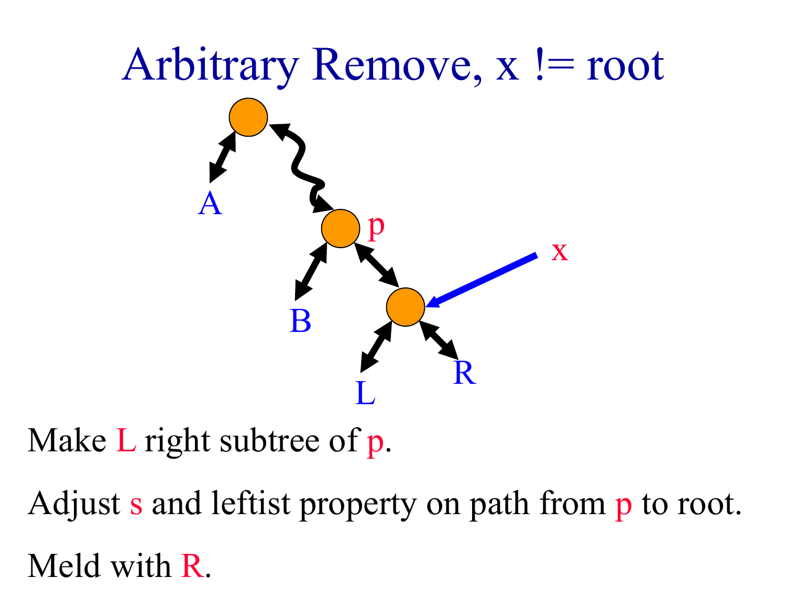

If $x$ is the root, this reduces to `removeMin()`. The final meld remains logarithmic; the additional repair work follows the affected ancestor path.

---

## 7. Quick Revision

**Operation summary**

| Operation | Time complexity |
| --- | ---: |
| Read minimum | $O(1)$ |
| Meld | $O(\log n)$ |
| Insert | $O(\log n)$ |
| Remove minimum | $O(\log n)$ |
| Initialize using a FIFO queue | $O(n)$ |
| Space | $O(n)$ |

Here, meld uses $n=n_1+n_2$ for the combined number of nodes.

**Key facts**

1. The $s$-value measures the shortest distance to an external node.
2. A leftist tree satisfies $s(\text{left})\geq s(\text{right})$ at every internal node.
3. The rightmost path is a shortest path and has length $s(\text{root})$.
4. The size bound $n\geq2^{s(\text{root})}-1$ implies a logarithmic right spine.
5. The whole tree need not be balanced; only the right spine is guaranteed to be short.
6. Meld keeps the smaller root, recurses on the right, swaps children when required, and updates $s$.
7. Insert and remove-min are simple applications of meld.
8. Pairwise FIFO melding constructs a leftist tree in linear time.

---

## 8. References

- E. Horowitz, S. Sahni, and D. Mehta, *Fundamentals of Data Structures in C++*, 2nd ed., Silicon Press, 2007.
- Lecture slides of Prof. Sartaj Sahni.


