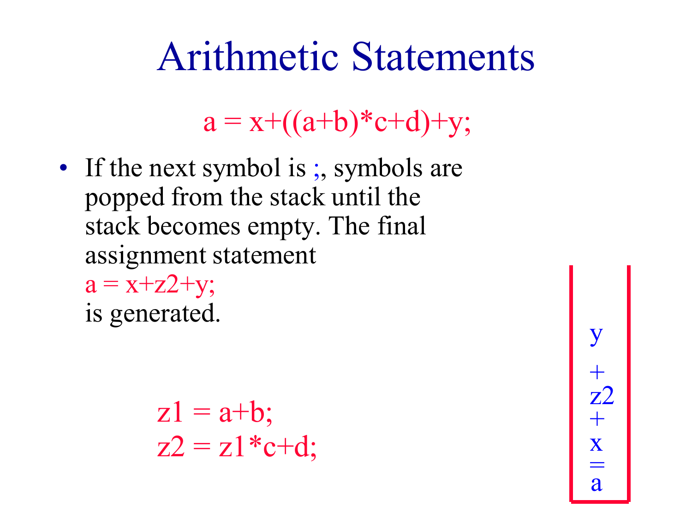
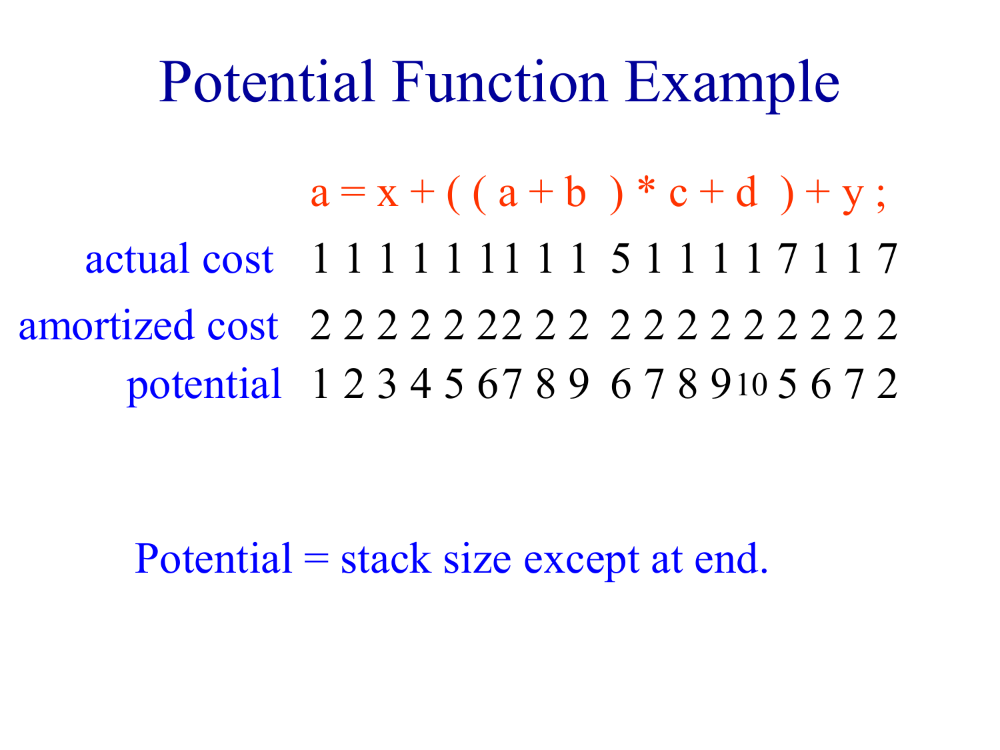
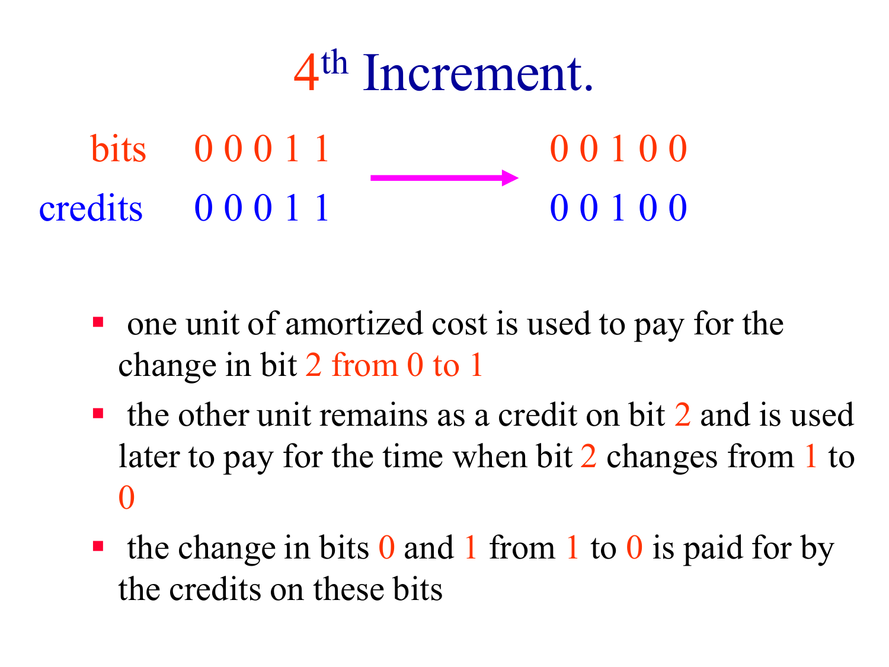
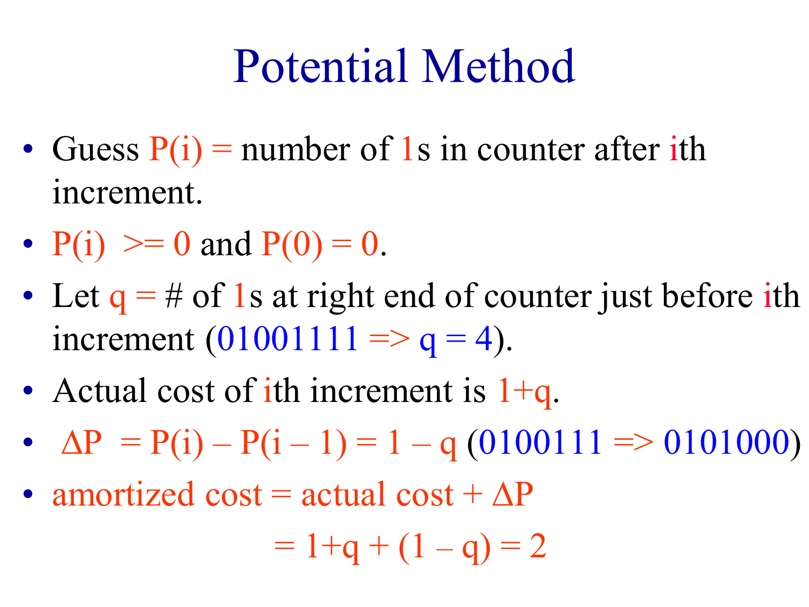

# Lecture 05 - Amortized Complexity

## 1. Lecture Map

Some operations are occasionally expensive but cheap most of the time. Bounding every operation by its individual worst case can therefore greatly overestimate the cost of a long sequence.

**Amortized analysis** distributes the total cost of a sequence across its operations. It gives a worst-case guarantee for the whole sequence without assuming a probability distribution over inputs.

> **Lecture flow:** distinguish worst-case, average, and amortized complexity -> define amortized charges and potential -> analyze stack-based expression processing -> apply the aggregate, accounting, and potential methods -> repeat the three analyses for a binary counter.

The three standard amortized-analysis methods are:

- Aggregate method
- Accounting method
- Potential-function method

---

## 2. Worst-Case, Average, and Amortized Complexity

**Worst-case complexity**

Suppose quicksort takes at most $10n^2$ microseconds on inputs of size $n$. This means:

- No input of size $n$ takes more than $10n^2$ microseconds.
- At least one input arrangement may attain that bound.

If an operation has worst-case cost $c_{wc}$, then $j$ operations always cost at most:

$$
jc_{wc}
$$

This is safe but can be loose when expensive operations cannot happen repeatedly.

**Average complexity**

Average complexity averages over a specified set or probability distribution of inputs. For example, if all $n!$ input permutations are considered equally likely, quicksort's average time can be computed by summing the times for all permutations and dividing by $n!$.

This does not imply that an arbitrary subset of inputs has the same average. If only 500 particular permutations are processed, the overall average across all $n!$ permutations does not bound those 500 by itself. The safe bound is still:

$$
500\times\text{worst-case time}
$$

**Amortized complexity**

Amortized complexity concerns a sequence of operations on one data structure or process. It does not average over random inputs.

Let:

- $c_i$ be the actual cost of operation $i$.
- $\hat c_i$ be the amortized cost charged to operation $i$.

The charges must guarantee, for every relevant operation sequence or prefix, that:

$$
\sum_{i=1}^{j}c_i
\leq
\sum_{i=1}^{j}\hat c_i
$$

An individual operation may be charged less than its actual cost. Earlier cheap operations can be overcharged so that saved credit pays for a later expensive operation.

| Analysis | What is averaged or bounded? | Probability required? |
| --- | --- | --- |
| Worst case | Every operation/input separately | No |
| Average case | Inputs under a stated distribution | Yes |
| Amortized | Total cost of an operation sequence | No |

> Amortized cost is not the same as average cost. It is a deterministic upper bound on the total sequence cost.

---

## 3. Amortized Charges and Potential

Let $\Phi_i$ denote the stored credit or **potential** after the first $i$ operations. Define:

$$
\Phi_i
=\Phi_{i-1}+\hat c_i-c_i
$$

Rearranging gives the standard potential-method formula:

$$
\hat c_i
=c_i+\Phi_i-\Phi_{i-1}
$$

Using:

$$
\Delta\Phi_i=\Phi_i-\Phi_{i-1}
$$

we can write:

$$
\hat c_i=c_i+\Delta\Phi_i
$$

Summing over $n$ operations causes the intermediate potential terms to cancel:

$$
\sum_{i=1}^{n}\hat c_i
=
\sum_{i=1}^{n}c_i+\Phi_n-\Phi_0
$$

Therefore:

$$
\sum_{i=1}^{n}c_i
=
\sum_{i=1}^{n}\hat c_i+\Phi_0-\Phi_n
$$

If:

$$
\Phi_n\geq\Phi_0
$$

then:

$$
\sum_{i=1}^{n}c_i
\leq
\sum_{i=1}^{n}\hat c_i
$$

A common choice is $\Phi_0=0$ and $\Phi_i\geq0$ for all $i$. Potential can be interpreted as prepaid work stored in the current state.

**Relation between the accounting and potential views**

- In the accounting method, credit is attached to individual objects or operations.
- In the potential method, all stored credit is represented by one function of the data structure's state.
- Both methods prove that previously collected credit covers future expensive work.

---

## 4. Stack Example - Rewriting Arithmetic Statements

Consider:

```text
a = x + ((a + b) * c + d) + y;
```

The goal is to rewrite it without parentheses:

```text
z1 = a + b;
z2 = z1 * c + d;
a  = x + z2 + y;
```

The algorithm processes the $n$ input symbols from left to right using a stack.

```text
create an empty stack

for each input symbol:
    processNextSymbol()
```

`processNextSymbol` behaves as follows:

- A symbol other than `)` or `;` is pushed onto the stack.
- When `)` is read, pop symbols through the matching `(`, generate a temporary assignment, and push the temporary variable back.
- When `;` is read, pop the remaining symbols and generate the final assignment.



**Why the simple analysis gives $O(n^2)$**

On iteration $i$, the stack can contain $O(i)$ symbols. If each call is bounded independently by $O(i)$, then:

$$
\sum_{i=1}^{n}O(i)=O(n^2)
$$

This is correct but loose. A symbol that is popped during one call cannot be popped again later.

**Aggregate analysis**

Across all calls:

- At most $n$ symbols are pushed.
- Every pushed symbol is popped at most once.
- Temporary variables are included in the push count because each one replaces a processed `)` symbol, and `)` itself is not pushed.

Thus:

$$
\text{total actual cost}
\leq n+n=2n
$$

Dividing by $n$ gives an amortized cost of at most 2 per call:

$$
\frac{2n}{n}=2
$$

Therefore the complete algorithm runs in $O(n)$ time.

**Accounting analysis**

Charge each call 2 units.

- When an ordinary symbol is pushed, use one unit to pay for the push.
- Store the second unit as credit on that stack symbol.
- When the symbol is eventually popped, its stored credit pays for the pop.
- When `)` creates and pushes a temporary variable, its two-unit charge pays for that push and stores credit for its later pop.

The stored credit never becomes negative, so the total amortized charge bounds the total actual work.

**Potential analysis**

Choose the potential to be the current stack size:

$$
\Phi_i=\text{number of symbols on the stack after operation }i
$$

For an ordinary symbol:

$$
c_i=1,
\qquad
\Delta\Phi_i=1
$$

$$
\hat c_i=1+1=2
$$

For `)`, let $k$ be the number of symbols popped, including `(`. The operation also pushes one temporary variable:

$$
c_i=k+1
$$

The stack size changes by $1-k$:

$$
\Delta\Phi_i=1-k
$$

Therefore:

$$
\hat c_i=(k+1)+(1-k)=2
$$

For `;`, suppose $k$ symbols remain on the stack. The actual cost is $k$. With the conventional choice $\Phi_n=0$ after emptying the stack:

$$
\Delta\Phi_n=-k
$$

$$
\hat c_n=k-k=0
$$

The total cost is still at most $2n$. The lecture instead sets the final potential to 2 so that the final call also has amortized cost 2:

$$
\Delta\Phi_n=2-k
$$

$$
\hat c_n=k+(2-k)=2
$$

Both choices prove an $O(n)$ total bound. The lecture's choice makes every displayed amortized charge equal to 2.



---

## 5. Binary Counter Example

Consider an $n$-bit binary counter that starts at zero. Define the cost of an increment as the number of bits that change.

For example:

```text
001011 -> 001100
```

Three bits change, so the actual cost is 3.


An individual increment can cost $n$:

```text
011111 -> 100000
```

Using the individual worst case for each of $m$ increments gives the loose bound:

$$
O(mn)
$$

**Aggregate analysis**

Number bits from right to left starting at bit 0.

- Bit 0 changes on every increment: $m$ times.
- Bit 1 changes every 2 increments: $\lfloor m/2\rfloor$ times.
- Bit 2 changes every 4 increments: $\lfloor m/4\rfloor$ times.
- Bit $j$ changes $\lfloor m/2^j\rfloor$ times.

The total number of bit changes is:

$$
\begin{aligned}
T(m)
&=m+\left\lfloor\frac{m}{2}\right\rfloor
+\left\lfloor\frac{m}{4}\right\rfloor+\cdots\\
&\leq m\sum_{j=0}^{n-1}\frac{1}{2^j}\\
&<m\sum_{j=0}^{\infty}\frac{1}{2^j}=2m
\end{aligned}
$$

Hence the amortized cost per increment is less than 2 and is therefore $O(1)$.


**Accounting analysis**

Charge 2 units for every increment.

When a bit changes from 0 to 1:

- Use one unit to pay for the current change.
- Store one unit of credit on the resulting 1 bit.

When that bit later changes from 1 to 0, its stored credit pays for the change.

During an increment, several trailing 1s may change to 0, but every one of those bits already holds the credit needed for its own reset. The two new units only need to pay for and place credit on the one bit that changes from 0 to 1.



The total stored credit equals the number of 1s in the counter, so it is always non-negative.

**Potential analysis**

Choose:

$$
\Phi_i=\text{number of 1 bits after increment }i
$$

Suppose the counter has $q$ trailing 1s immediately before an increment.

- Those $q$ trailing 1s change to 0.
- The next 0 changes to 1.

The actual cost is:

$$
c_i=q+1
$$

The number of 1s decreases by $q$ and then increases by 1:

$$
\Delta\Phi_i=1-q
$$

Therefore:

$$
\hat c_i
=c_i+\Delta\Phi_i
=(q+1)+(1-q)
=2
$$



Even though one increment may flip all $n$ bits, every increment has amortized cost 2, and $m$ increments cost $O(m)$ in total.

---

## 6. Comparing the Three Methods

All three methods prove the same type of sequence bound but organize the reasoning differently.

| Method | Main idea | Best used when |
| --- | --- | --- |
| Aggregate | Bound the total actual cost directly, then divide by the number of operations | The complete sequence can be counted easily |
| Accounting | Overcharge cheap operations and store object-level credits | It is natural to say which object saves and spends credit |
| Potential | Store all prepaid work in a function of the current state | A compact state measure captures future work |

For the two lecture examples:

| Example | Natural potential | Amortized cost |
| --- | --- | ---: |
| Expression processing | Number of stack symbols | At most 2 per symbol |
| Binary counter | Number of 1 bits | 2 per increment |

The aggregate method is often the simplest proof. The accounting and potential methods are more reusable because they can assign different amortized costs to different operation types without first deriving one global total.

---

## 7. Quick Revision

**Core formulas**

$$
\hat c_i=c_i+\Phi_i-\Phi_{i-1}
$$

$$
\sum_{i=1}^{n}c_i
=
\sum_{i=1}^{n}\hat c_i+\Phi_0-\Phi_n
$$

When $\Phi_n\geq\Phi_0$:

$$
\sum_{i=1}^{n}c_i
\leq
\sum_{i=1}^{n}\hat c_i
$$

**Key facts**

1. Amortized analysis is a deterministic sequence bound, not a probabilistic average.
2. An expensive operation can have small amortized cost because earlier operations prepaid its work.
3. Individual amortized charges may be smaller than individual actual costs; only the cumulative bound must hold.
4. In the stack example, every pushed symbol can be popped at most once, so all calls take $O(n)$ total time.
5. In the binary counter, bit $j$ changes only once every $2^j$ increments, so $m$ increments cause fewer than $2m$ bit changes.
6. Accounting credit and potential are two representations of the same prepaid work.
7. A useful potential function is non-negative, starts from a known value, and measures work stored for the future.

---

## 8. References

- E. Horowitz, S. Sahni, and D. Mehta, *Fundamentals of Data Structures in C++*, 2nd ed., Silicon Press, 2007.
- Lecture slides of Prof. Sartaj Sahni.
